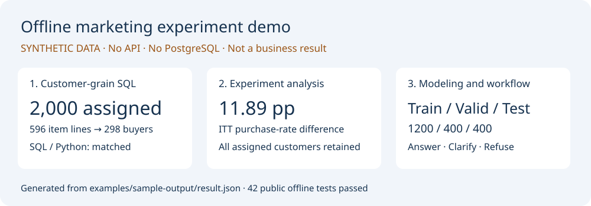

# 零售营销增量决策助手 · Retail Uplift Workbench

商店只能联系一部分顾客时，应该把促销邮件发给谁？买得多的人可能本来就会买。这个项目先用随机实验判断营销是否带来额外购买，再检验模型选人是否比同样人数的随机选人更有效，最后用 SQL 和受约束的 Agent 工作流把分析做成可核对的交付。

**个人数据科学作品｜Python 3.12+｜离线演示无需 API、PostgreSQL 或原始数据。**

[快速安装](docs/INSTALL.md) · [演示说明](examples/README.md) · [真实研究结果](docs/RESULTS.md) · [架构与代码导读](docs/ARCHITECTURE.md) · [复现范围](docs/REPRODUCIBILITY.md)

## 可以先看到什么

- **数据科学**：ITT 购买率差与置信区间；T-Learner；固定触达比例的策略评估；配对差值推断；AIPW 与固定阈值评估的研究实现。
- **SQL**：先归并交易粒度再聚合客户；保留未购买客户；SQL/Python 对账；完整产品使用 PostgreSQL 的只读查询账号。
- **Agent**：规则解析、结构化计划、条件校验、LangGraph 路由、澄清与拒绝；完整产品包含有限重试、归档和效果重算。最终数值报告由程序模板产生。
- **诚实边界**：没有真实投放与利润验证；不是通用问数、多 Agent 平台或 MCP 服务。完整产品主流程以程序路由为主，LLM 可选辅助澄清措辞。



## 三步运行小样本

在本目录打开终端，使用独立虚拟环境：

```bash
python -m venv .venv
```

Windows PowerShell：

```powershell
.\.venv\Scripts\python.exe -m pip install ".[dev]"
.\.venv\Scripts\python.exe -m dsa.portfolio_demo --out artifacts/demo
.\.venv\Scripts\python.exe -m pytest
```

macOS / Linux：

```bash
.venv/bin/python -m pip install ".[dev]"
.venv/bin/python -m dsa.portfolio_demo --out artifacts/demo
.venv/bin/python -m pytest
```

打开 `artifacts/demo/report.html` 或 `report.md`，查看统计结果、模型比较和请求分支。`result.json` 保存数值与划分，`workflow_cases.json` 保存计划与终态，`customer_outcomes.sql` 保存实际执行的查询。重复运行请换一个 `--out` 路径，避免覆盖已有证据。无需复制 `.env.example`。

默认演示生成 2,000 名虚构客户及商品明细，使用 SQLite 内存库演示交易粒度，再调用项目真实的统计、训练和策略评估模块。它使用一个小型 LangGraph 适配器绑定合成数据；完整 PostgreSQL 产品主图位于 `src/dsa/agent/graph.py`。**合成数据的数值不是 Hillstrom/Criteo 的实测结果。**

不安装也可以先看[已运行的合成样例](examples/sample-output/report.md)。

## 实际做出的结论

|研究|结果|解释边界|
|---|---|---|
|Hillstrom，64,000 名客户|男装主题邮件对无邮件的两周购买率差 **+0.6805 个百分点**，95% 区间 [0.5014, 0.8641]|以全部分配客户为分母；主比较为历史观察结果后选定，不能冒称前瞻预注册。|
|Hillstrom 选人探索|22 个模型评分配置 × 5 档比例，**110 项均未证实优于随机选人**；31 项点估计为正|旧测试集曾被查看，整体按探索性解释；不显著不等于无效。|
|Criteo v2.1，13,979,592 条发布记录|开发集首选普通购买预测 HGB31；约 10% 触达时，相对同预算随机基准的 **AIPW 评分差 +0.0757 个百分点**，35 项校正区间 [0.0632, 0.0881]|正结果仅限发布基准评分；未知且与结果相关的发布抽样可能破坏可比性，**尚未识别真实因果购买收益**，也未证实专门 uplift 方法胜过购买预测。|
|RetailHero 多表工程|完成交易粒度去重、特征构建与 SQL/Python 核对|不把该数据的工程处理冒充因果效果验证。|

完整说明：[Hillstrom 报告](reports/hillstrom/report.md)、[Criteo 报告](reports/criteo/report.md)、[结果与限制](docs/RESULTS.md)。三套数据独立分析，不拼接客户，不互作对照。

## 代码地图

```text
src/dsa/
  data/ features/         数据规格、导入、实验前特征
  stats/                 实验与统计计算
  models/                划分、T-Learner、策略对比、模型登记
  research/              AIPW、固定阈值、扩展候选的独立研究实现
  agent/ api/ tools/      PostgreSQL 完整产品、工具契约和归档
  resources/             随 wheel 打包的指标与 SQL
  portfolio_demo.py      无外部服务的合成演示适配器
sql/                     PostgreSQL 表结构和登记查询
scripts/                 完整产品的数据导入与分析入口
tests/                   公开版离线测试
reports/                 最终研究叙述、图表、聚合结果和协议
examples/                演示说明和已生成样例
```

建议从 [SQL 粒度 → ITT → 建模 → 策略差值 → 请求路由](docs/ARCHITECTURE.md) 阅读代码。

## 安装与验证的范围

轻量安装及本目录的完整离线测试是公开版验收范围。完整 Streamlit/FastAPI 产品另需 `pip install ".[full]"`、自行取得数据、初始化 PostgreSQL 并填写本地 `.env`，见[高级安装说明](docs/INSTALL.md#完整产品可选)。本次不把完整数据库部署、全量训练或真实模型 API 联调视为已重新验证。

原工程 2026-10-12 保存过 889 项测试的历史记录；该数字与本次公开版离线测试是两套证据，不能相加，也不能作为泛化效果或商业收益证明。

## 数据、许可与开发说明

仓库不包含原始公开数据、客户级预测、训练模型、数据库、API 交互原始载荷或第三方论文全文。下载地址、哈希和数据许可见[数据来源](docs/DATA_SOURCES.md)。代码与自有文档采用 MIT 许可；第三方数据和库保留各自许可，见 [THIRD_PARTY_NOTICES](THIRD_PARTY_NOTICES.md)。

项目使用 AI 辅助编码、调试与写作。本文按当前实现描述已完成能力；不能据此声称所有代码均独立手写，或把尚未掌握的内容写成个人能力。问题定义、统计口径、结果解释及代码验证仍需作者能独立讲清。

公开前检查说明见 [PUBLICATION_NOTES](docs/PUBLICATION_NOTES.md)，贡献方式见 [CONTRIBUTING](CONTRIBUTING.md)。
