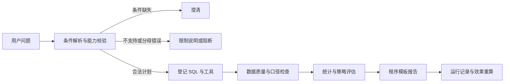

# 架构与阅读顺序

项目需要把一个业务问题转为可检查的计算。统计内核负责数字，模型负责排序假设，SQL 负责数据粒度，Agent 负责组织请求与保存证据。

上图描述完整产品。离线演示用 SQLite 与合成数据替代数据接入，另建小型 LangGraph 适配器，只复用适合离线调用的模块；并非完整主图脱离 PostgreSQL 的运行模式。

## 先读五处关键实现

|问题|代码|应当能解释什么|
|---|---|---|
|为什么金额会重复？|[演示 SQL](../src/dsa/portfolio_demo.py)、[RetailHero 特征](../src/dsa/features/retailhero_features.py)|明细粒度与交易粒度；先检查同一交易金额是否一致；左连接保留零交易客户。|
|实验分母是什么？|[比例统计](../src/dsa/stats/proportions.py)、[实验分析](../src/dsa/stats/experiment.py)|全部随机分配客户；比例差、百分点、区间；不按干预后行为筛选。|
|模型如何实现增量排序？|[特征](../src/dsa/models/features.py)、[T-Learner](../src/dsa/models/tlearner.py)、[划分](../src/dsa/models/split.py)|两个结果模型之差；只用实验前特征；预处理训练集拟合；不能把购买 AUC 当作策略收益。|
|为什么要直接比较策略差值？|[策略估计](../src/dsa/models/policy.py)、[研究估计量](../src/dsa/research/research_core.py)、[固定阈值](../src/dsa/research/frozen_policy.py)|总体分母、同预算随机基准、配对相关性、训练不确定性与测试不确定性。|
|怎样避免回答错问题？|[计划](../src/dsa/agent/planning.py)、[完整主图](../src/dsa/agent/graph.py)、[工具注册](../src/dsa/tools/registry.py)|指标、比较、窗口、过滤、排序、人数/比例必须得到明确处理；报告数字来自结构化结果。|

## 完整产品与研究分析的分工

`models/` 是已接入原产品的基础 T-Learner/SNIPS/登记链路；`research/` 是独立扩展估计器和候选实现。AIPW、扩展候选及 Criteo 研究结论尚未全部接入 Streamlit 工具。不要因源码同时存在就宣称所有研究功能已被自然语言入口调用。

`tools/` 和 `api/` 使用注册表和 Pydantic 契约；SQL 资源随 wheel 打包。Agent 查询使用只读角色，写运行记录使用另一连接。完整主图支持有限修复/重试和带记录重入；`replay` 的范围是效果重算，不是全部交互、训练或数据库快照恢复。

主路径以规则解析和程序路由为主，LLM 可选表达澄清；LLM 自主选工具是独立基线。当前不是自由 NL2SQL、通用多 Agent 或 MCP 服务器。
