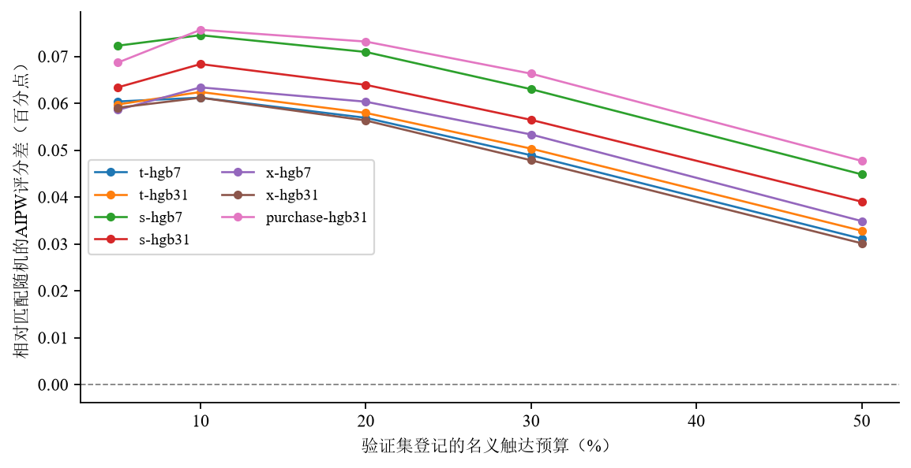
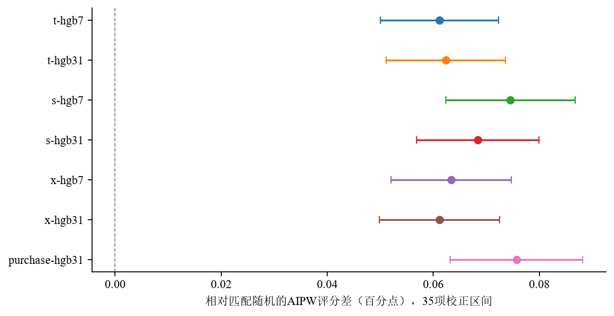

> 公开快照说明：本报告保留最终研究叙述与科学数字。协议、图表和部分聚合结果随附；文中提及的完整 sources、客户级预测、模型缓存、全量日志、reviews/versions 和 TeX/PDF 工程保留于原工作目录，不全部随公开版分发。参见[复现范围](../../docs/REPRODUCIBILITY.md)。

**报告版本：6。Criteo独立专题，可读性修订版；Hillstrom结果另行保留。**

## 摘要

企业投放广告，是希望让更多人购买商品。但有些人本来就打算购买，广告出现后产生的订单未必都是广告的功劳。广告机会有限时，企业更想知道，应该优先影响哪些人的购买决定。本报告利用历史广告记录研究这种选人方法，并检查它是否比随机选择更有效，以及现有数据能支持多强的判断。

具体分析以触达约10%客户为主要资源设定，比较模型选人与相同比例随机选人的购买结果。数据来自Criteo v2.1公开广告实验衍生文件，以conversion表示14天购买结果。分析始终围绕购买，不改用更容易发生的visit，也不按exposure或visit筛选客户。
实际能直接检验的是增强逆概率加权（AIPW）评分对比，即用统一公式比较模型名单与同预算随机基准。它是否能进一步解释为真实因果购买增量，取决于发布数据保留了哪些因果识别条件。

先在开发集选择规则，再查看测试结果。全部七个候选中，开发首选是基于直方图梯度提升树的普通购买预测HGB31；只看六个专门增量候选，首选是S-HGB7。测试集按行独立划分，共6,990,115条记录、20,397个购买标签。
购买预测规则相对相同实际预算随机选择的AIPW评分差为0.0757个百分点，35项Bonferroni校正区间为[0.0632, 0.0881]；S-HGB7为0.0745个百分点，区间为[0.0623, 0.0867]。因此，本轮确认了发布基准上的正评分对比。
但把这个统计结果解释成因果选人优势，还需要证明发布后的分配与结果满足交换性等条件，当前公开资料未提供足够依据。本研究也没有证实专门增量学习器优于普通购买排序。

因果解释的主要缺口来自数据发布方式。原数据经过匿名化、非均匀负样本抽样和处理比例重平衡，广告主与完整抽样信息未公开，原业务因果收益因此不能恢复。
报告将正结果限定在发布基准及相应假设下，尚未开展真实投放、独立新时期或利润验证。SQL与Agent负责工程支撑，本轮无模型API调用或数据库写入。

**关键词：** 购买增量；固定阈值策略；S-Learner；AIPW；独立验证；公开基准

# 研究问题与数据选择

一位顾客看过广告后买了商品，企业很难仅凭这笔订单判断广告是否有用：顾客可能早就打算购买，也可能正是被广告打动才作出决定。如果只能向部分人提供广告机会，就还要回答，这些机会该留给谁。本研究使用历史广告记录，尝试学习一种选人方法，既检查它是否更可能带来额外购买，也检查这些记录是否足以说明这种效果。

Hillstrom男装主分析的110项组合均未确认模型优于随机选人，结果与原因在独立报告中完整保留。按用户继续探索正效果并新增公开实验数据的要求，本轮选择规模更大的Criteo。
这是另一场景的方法探索。两套数据的对象、广告内容、特征和购买率不同，因此分开建模、评估和报告，不合并客户，也不直接用效果大小比较方法的普适性。

分析仍区分两个问题：广告相对不干预是否平均有效，以及模型选人是否比同预算随机选人多带来价值。本报告重点研究后者。
购买标签使用发布文件中的真实记录，未人为合成；已知真值模拟在后文单列。数据版本和来源依据见[原作者论文](#ref-criteo2021)及[官方数据卡](#ref-criteodata)。

# 数据来源及因果解释的限制

实际文件为criteo-research-uplift-v2.1.csv.gz，含13,979,592条发布记录，大小311,422,618字节。文件SHA-256为2716e1bf0fd157a93b5bf86924d9088419dfbac2022c6cd90030220634f616dc，与官方镜像清单及TensorFlow Datasets登记一致。
旧介绍中的25M/11特征对应不同说明，本报告以实际v2.1文件为准，使用12个实验前字段。

这里的T=1表示客户可进入广告触达方案，T=0表示该方案的控制组；之后是否实际曝光由exposure记录。分配与曝光是不同变量，因此分析比较的是广告方案分配，而非简单比较看过广告与没看过广告的人。
conversion记录分配后两周内的购买。曝光、访问和购买既不作为选人特征，也不用于筛选分母。公开记录已匿名化，缺少原cookie和广告主标识，无法核实跨广告主是否有重复用户。

原作者用v2修正了不同广告主实验比例混合的问题，发布后的处理比例约85%。
不过，公开文件对负样本并非等概率抽取，原广告主、随机化区组及完整抽样概率也未公开，留下的记录已不再保持原业务分布。
因此仅凭发布文件，无法恢复原业务购买率、绝对增量或利润，本轮估计也不提供原线上广告净收益的证据。
主分析暂把e=0.85代入统一评分公式。总体比例不能保证每类特征X的人群都以0.85的概率进入处理组，这项设定需作敏感性检查。
更关键的是，若记录能否公开取决于实际结果或处理，筛选后的人群可能失去原来的可比性。令A=1表示进入公开文件，其分配概率满足：
$$
P(T=1\mid X,A=1)=
\frac{e\,P(A=1\mid T=1,X)}{e\,P(A=1\mid T=1,X)+(1-e)P(A=1\mid T=0,X)}.
$$
可见，原实验的随机T不保证发布后$Y(t)$与T在给定X下仍可交换。
估准发布后的分配概率也只是其中一部分，未知的结果抽样机制仍需额外信息处理。
因此缺口涉及两层：原业务效果不能直接外推，发布样本人群内部的真实因果优势也尚未被现有资料识别。

实验前特征能否预测分配，也可提供诊断线索。验证集中，用X预测T的AUC为0.5104，数值特征最大绝对标准化均值差约0.0202。这些值不能证明发布后仍完全随机或不存在混杂，仍需检查固定e假设的敏感性。
结果模型校准、抽样、跨实验重复与干扰也是因果解释的限制。数据与软件许可分别处理：本数据卡为CC BY-NC-SA 4.0，仅用于个人非商业研究，源码包不附原始数据。

# 分析前确定的数据划分与候选

用种子20261021逐行生成伪随机划分，比例为35%训练、15%验证、50%测试，不根据T或Y分层，实际人数见下表。
编码和模型只用训练数据拟合；验证数据选择候选、阈值和并列规则。选择固定后才评价测试结果，看过测试后不重新训练或选模。

| 划分 | 组别 | 记录数 | 购买标签数 | 购买率 |
| --- | --- | --- | --- | --- |
| train | 不参与广告 | 734,312 | 1,360 | 0.1852% |
| train | 可参与广告 | 4,158,177 | 12,860 | 0.3093% |
| validation | 不参与广告 | 313,605 | 643 | 0.2050% |
| validation | 可参与广告 | 1,783,383 | 5,514 | 0.3092% |
| test | 不参与广告 | 1,049,020 | 2,060 | 0.1964% |
| test | 可参与广告 | 5,941,095 | 18,337 | 0.3086% |

*标签无关划分的实际记录与事件*

连续变量为f0、f2、f7、f10，其余8列按匿名类别处理。每列仅保留训练数据中最常见的200类，其他取值归OTHER。编码先匹配原始浮点类别，再转为float32，避免精度转换把不同类别错误合并。
模型输入矩阵使用float32，HGB按原生类别方式切分，不把匿名编码误当成有业务大小关系的数值。这项编码降低了计算负担，也会损失类别信息，尚不能称为最优方案。

候选提前登记为T/S/X三类学习器，各配7叶与31叶HGB，另加普通合并购买预测HGB31。共同参数为120轮、学习率0.05、每叶至少1000人、L2=30，关闭早停与类权重，固定种子并用两线程。
普通购买基线在查看任何验证评分与测试结果前加入协议，与增量候选具有相同选择资格。主要选择是在名义10%预算下，取全部七候选中验证AIPW评分差最高的一项；同时记录六个增量候选中的首选。

配置、预算、选择和首次测试结果分别保存，后续敏感性分析另存，不覆盖首次结果。test_results.json记录验证选择清单的哈希，可检查两者是否匹配。执行顺序也是先保存验证选择，再读取测试结果进行评估。

# 模型怎样形成选人排序

## T、S与X三种学习思路

T-Learner为处理组和控制组各拟合一个购买模型，以两者预测概率之差评分：
$$
\hat\tau(x)=\hat\mu_1(x)-\hat\mu_0(x).
$$
两组可以有不同的购买规律，但控制组较小，两个模型的误差都会传入最终差值。
S-Learner把X和T放入同一购买模型。评分时保持客户特征不变，分别代入T=1和T=0，再取两次购买概率之差。
这种共享可能降低方差，也可能忽略较弱的处理交互，需要评估实际排序。
两种方法都需区分识别和学习：实验及发布机制决定能否作因果解释，有限数据中的模型是否学到有用排序，则由评估判断。

X-Learner先用一组的购买模型预测另一组的反事实，构造插补差异，再分别学习差异函数。本轮按e=0.85组合两侧模型：控制侧差异模型权重为0.85，处理侧为0.15，以适配两组人数不平衡。
插补差异提供学习目标，但不是观测到的个体因果真值。[Metalearner原论文](#ref-kunzel2019)给出方法框架，本轮具体参数与行为以保存源码为准。

## 为什么还要比较普通购买预测

普通基线把历史混合分配数据合并，预测购买倾向，选人时不输入T。高购买倾向与高干预响应在定义上不同，但在某些人群中可能相关，所以普通排序也可能表现良好。
本轮它在开发集胜出，说明专门uplift算法不天然占优。测试中的正评分支持该冻结规则的统计表现；发布后识别尚未确认，不能进一步认定真实因果价值，更未证明专门增量方法胜过购买预测。

## 预算阈值固定后，实际会选多少人

每个候选在验证集确定5%、10%、20%、30%、50%预算对应的分数阈值，同分以固定行号哈希区分。之后将模型、阈值和并列规则原样用于测试，不在测试集重新排名以凑足精确配额。
所以10%只是名义目标，实际入选比例略有变化：购买首选为9.9864%，S-HGB7为9.9860%。每个规则都对照相同实际比例的随机选择期望，保证自身预算匹配。不同模型实际比例略异，其原始策略值不能直接作为严格等预算的方法差值。

Hillstrom的规则是在每次重抽样内重新选round(qn)人，Criteo则使用固定阈值，两者评估对象不同。若未来每批必须精确选K人，就应另外登记选人规则及其推断方法，不能直接沿用本报告区间。

# 统一评分与不确定性评估

## 从结果预测到AIPW评分

评估采用一套共同的结果预测：m0表示控制条件的购买概率预测，m1表示处理条件的预测，两者用T-HGB31仅在训练集拟合。七候选都用同一套评估分数，避免各用各的评价标准。
在分配概率已知这一假设下，增强逆概率加权分数为：
$$
\Gamma_i=m_1(X_i)-m_0(X_i)
+\frac{T_i}{e_i}\{Y_i-m_1(X_i)\}
-\frac{1-T_i}{1-e_i}\{Y_i-m_0(X_i)\}.
$$
公式把购买概率差与实际结果残差结合，目的是修正预测误差，不是创造新的购买事件。
若要作因果解释，还需发布后的处理分配满足相应随机化或给定特征下无混杂假设，并满足重叠、处理一致性、完整结果记录及单位独立等条件。
固定e与结果模型若同时错误，AIPW不保证无偏。“双重稳健”并不能替代这些条件或修复任意数据问题。

先把能直接计算的统计对象写清楚。以下协方差比较名单选择与统一AIPW分数的关联：
$$
D_\Gamma(\pi)=\operatorname{Cov}_{A=1}(\pi(X,H),\Gamma_{e_0}),\qquad e_0=0.85.
$$
同分时用H决定先后；它只由固定原行号生成，不读取T或Y，因此也是选人规则的一部分。后文把该规则简写为$\pi$。
行号仅用于本次并列处理，并非业务特征，真实部署需重新登记稳定机制。
只有发布后仍满足交换性、重叠和一致性等条件，并且$E[\Gamma\mid X,H,A=1]=\tau(X,H)$，这个评分对象才等于因果策略优势。
在这些额外条件下，令$q=E[\pi]$，因果目标可以写为：
$$
\Delta=E_{A=1}[\pi(X,H)\tau(X,H)]-qE_{A=1}[\tau(X,H)]
=\operatorname{Cov}_{A=1}(\pi(X,H),\tau(X,H)).
$$
本报告直接估计的是前述评分协方差，尚未验证它与因果目标相等所需的条件。以全部评估记录为分母，令$q_n=n^{-1}\sum_i\pi_i$，估计
$$
\widehat D_\Gamma=\frac1n\sum_i(\pi_i-q_n)\Gamma_i.
$$
随机基准取q_n倍AIPW ATE，表示同预算随机规则的期望表现，不依赖某一张恰好抽出的随机名单。
评分差以全体评估记录为分母，采用二元购买结果的比例尺度并换算为百分点；
只有额外因果识别条件成立时，才具有总体购买率增量的解释，它不是已触达名单内的购买率差。

## 固定模型和规则后的近似区间

Criteo规则的阈值已在测试前固定，采用协方差影响函数计算标准误。影响函数描述每条评估记录对估计值的影响；这里不使用Hillstrom的重排名bootstrap：
$$
\widehat{IF}_i=(\pi_i-q_n)(\Gamma_i-\bar\Gamma)-\widehat D_\Gamma,\qquad
\widehat{SE}=\frac{\operatorname{sd}(\widehat{IF})}{\sqrt n}.
$$
计算时把所有训练、验证拟合对象和规则视为固定。区间包含测试人群中实际入选比例及评分均值的估计变化，但未包含重训、重选、原抽样、广告主聚类或跨时期变化。
它采用各行独立同分布（IID）假设下的大样本正态近似，未提供有限样本或原随机化设计下的精确保证。

全部7候选各有5档阈值，共35项差值，每项都与相同实际预算的随机期望比较。为考虑同时查看这些结果，使用双侧Bonferroni区间，临界值为$z_{1-0.05/(2\times35)}=3.1888$。
这项整体校正仅覆盖这35项；敏感性、半样本和直接方法比较需另行解释。35项正值也并非35次独立实验复制。

# 测试结果与可以支持的判断

## 名义10%预算：全部候选的结果

| 评分规则 | 实际触达比例 | 评分差（百分点） | 名义95%区间 | 35项校正区间 |
| --- | --- | --- | --- | --- |
| T-HGB7 | 10.0004% | 0.0612 | [0.0543, 0.0681] | [0.0500, 0.0723] |
| T-HGB31 | 9.9866% | 0.0624 | [0.0555, 0.0693] | [0.0512, 0.0737] |
| S-HGB7 | 9.9860% | 0.0745 | [0.0670, 0.0820] | [0.0623, 0.0867] |
| S-HGB31 | 9.9896% | 0.0684 | [0.0613, 0.0755] | [0.0568, 0.0799] |
| X-HGB7 | 10.0017% | 0.0634 | [0.0564, 0.0703] | [0.0521, 0.0747] |
| X-HGB31 | 10.0058% | 0.0612 | [0.0542, 0.0681] | [0.0499, 0.0725] |
| 购买预测HGB31 | 9.9864% | 0.0757 | [0.0680, 0.0833] | [0.0632, 0.0881] |

*名义10%预算下全部七个评分规则*

开发首选购买预测规则选中698,061条记录，其中处理侧602,381、控制侧95,680，购买标签分别16,176与1,813。S-HGB7选中698,030条，购买标签分别15,641与1,736。
这些数值描述名单构成，其中的购买并非全由广告造成，不能直接当作新增购买。

购买首选的AIPW评分可分成两部分：以全体测试记录为分母，模型名单分量mean(pi*Gamma)为0.0855个百分点，匹配预算的随机分量q_n*mean(Gamma)为0.0098个百分点，差为0.0757个百分点。只有额外因果识别条件成立，前两项才分别具有相对不干预的策略价值和随机策略价值解释。
S-HGB7的评分差换算到每万记录为7.45，仍只是评分加总，既不是实际多出的购买者，也不是已确认的因果新增购买期望。由于没有实际投放，且未知原业务抽样校正和成本，不能换算上线新增人数或真实收入。

全部35项的点估计、名义区间下界和登记校正区间下界均高于0。主结论仍围绕开发集先选出的规则，不从测试结果重新选最好者。
普通购买首选与S-HGB7尚未做严格等预算的方法优越性检验，因此本报告不判断谁已被证实更强。

[全部预算曲线](#fig:criteo-curves)展示各登记阈值下的评分差，[10%规则区间](#fig:criteo-ten)则把同一名义预算的候选放在一起，便于比较结果及不确定性。

## 更换评估设定后，方向是否保持

购买首选的无调整IPW评分差为0.0881个百分点，SNIPS核对为0.0677个百分点，点值都为正。这只是不同估计形式的方向核对，并未为各估计量完成同样的区间检验，也不是独立复制。
预定哈希划分的两个测试半样本，评分差为0.0820和0.0693个百分点。它们共享训练与选择过程，不能解释为跨时期或跨广告主复现。

| 结果模型 | 测试AUC | 测试Log Loss | 平均预测 | 实际购买率 |
| --- | --- | --- | --- | --- |
| 对照 | 0.9435 | 0.009486 | 0.1506% | 0.1964% |
| 干预 | 0.9561 | 0.012669 | 0.2999% | 0.3086% |

*共享T-HGB31结果模型的购买预测诊断*

结果模型能够区分购买倾向，但对照组平均预测低于实际购买率，概率校准仍有偏差。购买AUC衡量预测排序，本轮关于选人的正向统计证据来自预算匹配的AIPW评分差；其因果解释还需前述识别条件。
相对Hillstrom，Criteo记录和购买事件更多，购买预测信号也更强。这些有利观察伴随数据与干预差异，无法把正评分精确归功于样本量或某个算法。

先把固定e改为0.84、0.85、0.86，购买首选评分差依次为0.0784, 0.0757, 0.0726个百分点。随后再探索用特征估计分配概率。
追加登记发生在主测试已经运行期间：北京时间08:17:59开发选择固定，08:23:03登记amendment02，08:27:59主结果JSON落盘。执行者记录当时未查看测试效果，但缺少物理隔离或访问审计佐证，因此按探索性追加解释，不称为测试解封前预注册。原购买模型、规则和选择均不变。

| 规则 | 固定e评分差（百分点） | 估计e后评分差（百分点） | 名义区间（百分点） |
| --- | --- | --- | --- |
| 购买预测HGB31 | 0.0757 | 0.0700 | [0.0617, 0.0784] |
| S-HGB7 | 0.0745 | 0.0689 | [0.0608, 0.0771] |

*固定规则、条件于拟合ehat的探索性评分区间*

这组区间固定了已拟合的结果模型、分配模型和规则，不包含训练误差、模型错设、未知抽样或聚类，也不在主35项整体保证内。
估计分配概率后，购买首选与S首选点值较固定e下降约7.44%和7.48%。所选名单实际处理比例为86.2935%和86.3609%，全测试为84.9928%。这些比例描述分配差异，尚不能确定混杂存在或可以忽略。

估计分配概率范围为0.8418至0.9219，未触发预设0.05至0.95裁剪。方向仍为正，提示评分对这一设定有一定稳健性，但不证明分配模型正确，也不恢复原业务因果效果。
敏感性结果单列，没有据此改选模型或替换首次主分析。

# 已完成的核查与仍缺少的证据

核查覆盖数据文件、实验前特征、标签无关划分、仅训练集拟合、先验证选择再测试、完整披露、实际预算匹配、35项区间校正，以及IPW/SNIPS和分配敏感性。
独立脚本还重建划分，重算验证35项、测试35项及区间，79项数值和来源检查全部通过。这些记录支持计算与来源的一致性。

首次已知真值模拟固定经验风险人群和10%名单，仅重新生成T与Y，使用e=0.85。它检查这一窄生成机制下的估计公式，未包含随机X、实际比例q_n变化或模型学习，也不模拟发布时非均匀抽样及广告主聚类。

| 场景 | 真实评分差（百分点） | 平均估计 | 覆盖率 | 双侧拒绝率 |
| --- | --- | --- | --- | --- |
| zero | 0.0000 | 0.0006 | 93.0% | 7.0% |
| positive | 0.0180 | 0.0178 | 93.0% | 27.5% |

*每场景400次、20万记录的已知真值模拟*

首次模拟覆盖率为93%，低于名义95%；400次重复存在Monte Carlo误差，零效果拒绝率为7%，而非恰好5%。因此只能把它作为有限场景下的公式检查。实际测试规模更大，仍需渐近和IID假设，样本量本身不能证明假设成立。
第一轮审阅后追加随机X场景：每次重新生成风险人群、入选比例、T和Y，仍使用已知结果概率。参数与种子固定，首次结果保留，不由追加结果替换。

| 随机X场景 | 真实评分差（百分点） | 覆盖率 | 双侧拒绝率 | 比例标准差（比例单位） |
| --- | --- | --- | --- | --- |
| zero | 0.0000 | 94.5% | 5.5% | 0.000661 |
| positive | 0.0180 | 93.5% | 30.5% | 0.000674 |

*审阅后新增随机X模拟，每场景400次*

新增模拟补充检查了实际入选比例变化时的公式表现，但仍未涉及原发布抽样、聚类和模型训练误差。模拟覆盖接近名义水平，也不能弥补真实数据的因果识别缺口。

后续仍需验证原始未变换业务效果、广告主或用户聚类、跨时期稳定性、精确K名单实施、真实投放、成本利润，以及专门增量模型相对购买预测的额外价值。
若开展新实验，应先固定模型与规则，随机分配到不同策略，使用相同触达资源，并保留全部策略分配客户作为购买指标分母。新企业数据还需独立审计，当前公开基准正评分不足以直接批准投放。

# 工程实现与复现

数据与脚本独立保存于substudies/criteo，未改变产品默认模型或生产SQL。建模采用普通CPU可训练的HGB组合，AI用于辅助编程和整理材料；本轮未增加自由NL2SQL、多Agent、自动投放或大模型联调。
下载、数据准备、建模、独立核对、敏感性、绘图和排版分别运行，编译不触发训练。需要留意，训练入口会复用现有joblib，但尚未自动核对完整训练、配置及代码绑定。本次日志显示七候选均实际拟合，权重指纹也已保存；这仍不代表任意目录状态下可安全重训。
默认复现先用verify_criteo.py核对保存预测。新训练协议应使用隔离研究版本，防止旧缓存干扰或覆盖首次结果。原始压缩数据约311MB，数据、分数和模型在本地保存，不进入代码或TeX交付包。

讲解时应能说明为什么采用同预算随机期望、分配为何不同于实际曝光、S模型如何两次预测，以及验证选择为何必须先于测试。还应解释普通购买排序可能表现良好的原因、实际预算的偏差、影响函数覆盖的不确定性和发布抽样的因果限制。
这些问题决定读者能否理解并复查正结果，模型名称数量和图形外观不能替代它们。

原实证分析已完成3轮独立审阅，反馈、回应及各版均保留。本版改写表达，审阅记录仍只是核查过程，不替代数据验证。

# 结论

七候选中，开发集选出的普通购买预测HGB31，在测试发布分布上的AIPW评分对比为正；六个专门增量候选中的开发首选S-HGB7也为正。这是本轮已经验证的统计结果。
真实因果购买优势还需要发布后的分配与抽样条件支持。当前公开资料不足以确认这些条件，所以无论发布人群内部还是原广告业务，真实因果收益都尚未证实。专门增量方法优于购买排序、或两者等效，同样没有经过验证。
Hillstrom的110项未证实结果继续单独保留。两份报告共同说明：方法的评价既要看评分与区间，也要看数据设计能否支持目标解释。

# 附录：完整35项与证据入口

| 规则 | 名义预算 | 实际比例 | 评分差（百分点） | 35项校正区间 |
| --- | --- | --- | --- | --- |
| T-HGB7 | 5% | 4.9905% | 0.0604 | [0.0494, 0.0714] |
| T-HGB7 | 10% | 10.0004% | 0.0612 | [0.0500, 0.0723] |
| T-HGB7 | 20% | 19.9998% | 0.0569 | [0.0465, 0.0673] |
| T-HGB7 | 30% | 29.9992% | 0.0489 | [0.0396, 0.0582] |
| T-HGB7 | 50% | 50.0429% | 0.0311 | [0.0237, 0.0385] |
| T-HGB31 | 5% | 5.0026% | 0.0597 | [0.0486, 0.0709] |
| T-HGB31 | 10% | 9.9866% | 0.0624 | [0.0512, 0.0737] |
| T-HGB31 | 20% | 19.9999% | 0.0579 | [0.0474, 0.0684] |
| T-HGB31 | 30% | 30.0186% | 0.0503 | [0.0409, 0.0598] |
| T-HGB31 | 50% | 50.0526% | 0.0328 | [0.0254, 0.0402] |
| S-HGB7 | 5% | 4.9926% | 0.0723 | [0.0602, 0.0843] |
| S-HGB7 | 10% | 9.9860% | 0.0745 | [0.0623, 0.0867] |
| S-HGB7 | 20% | 19.9822% | 0.0709 | [0.0596, 0.0823] |
| S-HGB7 | 30% | 29.9979% | 0.0630 | [0.0529, 0.0731] |
| S-HGB7 | 50% | 50.0366% | 0.0448 | [0.0374, 0.0523] |
| S-HGB31 | 5% | 4.9808% | 0.0634 | [0.0519, 0.0749] |
| S-HGB31 | 10% | 9.9896% | 0.0684 | [0.0568, 0.0799] |
| S-HGB31 | 20% | 19.9820% | 0.0639 | [0.0532, 0.0747] |

*全部35项发布基准结果（1）*

| 规则 | 名义预算 | 实际比例 | 评分差（百分点） | 35项校正区间 |
| --- | --- | --- | --- | --- |
| S-HGB31 | 30% | 29.9985% | 0.0565 | [0.0468, 0.0661] |
| S-HGB31 | 50% | 50.0834% | 0.0390 | [0.0316, 0.0464] |
| X-HGB7 | 5% | 4.9876% | 0.0586 | [0.0474, 0.0698] |
| X-HGB7 | 10% | 10.0017% | 0.0634 | [0.0521, 0.0747] |
| X-HGB7 | 20% | 20.0149% | 0.0603 | [0.0497, 0.0710] |
| X-HGB7 | 30% | 29.9793% | 0.0533 | [0.0437, 0.0629] |
| X-HGB7 | 50% | 50.0077% | 0.0349 | [0.0274, 0.0423] |
| X-HGB31 | 5% | 4.9817% | 0.0591 | [0.0478, 0.0703] |
| X-HGB31 | 10% | 10.0058% | 0.0612 | [0.0499, 0.0725] |
| X-HGB31 | 20% | 20.0182% | 0.0563 | [0.0459, 0.0668] |
| X-HGB31 | 30% | 30.0153% | 0.0478 | [0.0384, 0.0573] |
| X-HGB31 | 50% | 50.0256% | 0.0301 | [0.0227, 0.0376] |
| 购买预测HGB31 | 5% | 4.9801% | 0.0687 | [0.0562, 0.0811] |
| 购买预测HGB31 | 10% | 9.9864% | 0.0757 | [0.0632, 0.0881] |
| 购买预测HGB31 | 20% | 19.9753% | 0.0732 | [0.0616, 0.0847] |
| 购买预测HGB31 | 30% | 30.0119% | 0.0663 | [0.0561, 0.0766] |
| 购买预测HGB31 | 50% | 50.0717% | 0.0477 | [0.0403, 0.0551] |

*全部35项发布基准结果（2）*

证据可按分析顺序查阅：protocol.json和protocol_amendment_01.json登记候选与基线，protocol_amendment_02.json登记额外分配敏感性；results/selection_before_test.json保存首次选择及阈值，results/test_results.json与all_test_results.csv保留完整结果。
sources/test_predictions.parquet保存行号、分配、购买结果、结果预测和七个分数。类别映射、模型文件、数据指纹及独立核对日志同目录可查。分数用于排序，并非已知的个体真值，不能作为谁必然受益的标签。

旧结果primary_target_met=true和协议success只表示登记的评分阈值达到；它们没有检验真实因果目标是否完成。

为避免误读，另存result_interpretation.json，将两层判断分别记为score_criterion_met=true和causal_purchase_gain_verified=false，并绑定原结果哈希。首次结果保持不变。

# 资料来源与实际阅读范围

 [原作者论文：A Large Scale Benchmark for Individual Treatment Effect Prediction and Uplift Modeling（2021）](https://arxiv.org/pdf/2111.10106)。
已读取数据来源、匿名化、版本修正、字段类型与实验设计相关正文，未逐页复核全部论文实验。

 [Criteo官方Hugging Face数据卡](https://huggingface.co/datasets/criteo/criteo-uplift)。
已读取数据卡与文件清单并核验实际文件；早期介绍与v2.1关键数字差异按文件和2021论文处理。

 [Künzel等，Metalearners（PNAS，2019）](https://doi.org/10.1073/pnas.1804597116)。
核对摘要与出版身份；未以其全文作为本轮实现逐行背书。

原分析实际读取了Criteo作者GitHub中UM notebook相关源单元和um_models.py，其主要目标为visit。本轮以购买为目标单独建模，不是该notebook的复现。HGB参数另按scikit-learn官方说明核对，实际行为由保存源码、测试和预测记录确定。
