> 公开快照说明：本报告保留最终研究叙述与科学数字。协议、图表和部分聚合结果随附；文中提及的完整 sources、客户级预测、模型缓存、全量日志、reviews/versions 和 TeX/PDF 工程保留于原工作目录，不全部随公开版分发。参见[复现范围](../../docs/REPRODUCIBILITY.md)。

**报告版本：6。Hillstrom独立实证报告，可读性修订版。**

## 摘要

设想一家商店准备给顾客发送促销邮件，但只能联系其中一部分人。邮件该发给谁？有些顾客本来就会买，发邮件未必增加销量；另一些顾客可能因为收到邮件才决定购买。本报告要研究的，就是能否利用过去的记录挑出更值得联系的顾客，并检查这种选法是否真的比随机挑人多带来购买。

为检验这种选人方法，本报告检查现有“零售营销增量决策助手”从业务问题、因果识别、响应差异建模到策略评估的完整过程。
分析使用Hillstrom随机邮件实验中的男装主题邮件组和无邮件组，结果为分配后14天内是否购买。基础比较先复现原逻辑回归T-Learner，再加入参数预先固定的受约束树T-Learner。两者均分别预测有邮件和无邮件时的购买概率，再用概率差给客户排序。
围绕这两种模型，报告检查购买概率预测、按增量分数分组的实际效果、30次训练扰动后的名单变化，以及配对策略评估、增强逆概率加权（AIPW）残差修正估计和已知真值模拟。

既有测试集包含8,523名客户，实际购买仅83次。按10%预算选人时，逻辑回归名单中有16次购买，事先固定的随机名单中有5次。相对于总行数，购买事件数量更能说明这次评估有多少信息。
全体历史客户中，分配到邮件方案的平均效果（ITT）为0.6805个百分点，Newcombe区间为[0.5014, 0.8641]。但邮件整体有效，并不意味着模型选人还能增加收益：逻辑回归和受约束树相对同预算随机选择期望的AIPW优势分别为0.0275和0.0749个百分点，区间为[-0.1524, 0.1905]和[-0.0804, 0.2306]，均包含0。
扩展探索又比较了21个增量候选和1个普通购买预测基线。模型先在开发集选择，再完整报告既有测试集结果。110项模型与预算组合中，31项点估计为正，0项名义区间下界高于0，仍未确认购买选人优势。
训练扰动也显示名单变化较大。两种基础模型前10%名单与原名单的Jaccard重合度中位数分别为0.418和0.321。

这些结果使后续问题更具体：估计精度是否足够，购买概率是否估得合理，增量排序能否区分人群，以及名单是否稳定。报告沿着这些问题诊断未能检出优势的原因，并给出下一轮策略随机实验的设计依据。
既有测试集此前已被查看，因此新增真实数据比较均按探索性结果解释。模拟和经济分析各自依赖明确假设，本项目尚未进行真实投放实验。SQL与Agent负责正确取数、统一口径、执行分析和保存证据，模型的增量价值仍由实验和评估检验。

**关键词：** 增量建模；因果推断；T-Learner；离线策略评估；AIPW；实验设计

# 研究问题与决策目标

## 从一封促销邮件说起

商店发完促销邮件，看到有人下单了，却还不能知道这些订单是不是邮件带来的：有些顾客即使没收到邮件也会买。若下一次只能联系部分顾客，商店真正想知道的是，应该把邮件发给谁，才能在同样的人数限制下带来更多原本不会发生的购买。本研究从这个日常经营问题出发，利用一次历史邮件实验，检验能否从数据中学会更有效地选人。

客户本来的购买倾向不同。按购买概率选人，可能优先选中即使没有邮件也会购买的客户，从而浪费有限预算。
因此需要分别回答：邮件平均能否增加购买？在相同预算下，模型选人能否比随机选人进一步增加购买？这两个问题并无必然联系。总体平均处理效果ATE为正时，客户响应仍可能几乎相同；总体无效时，也可能存在受益的子群。

报告依次说明增量如何定义、模型如何把响应差异转为选人决定，以及实际数据能为策略价值提供多强的证据。[增量决策链路图](#fig:flow)给出这几步之间的关系，也为后续方法和结果提供阅读顺序。

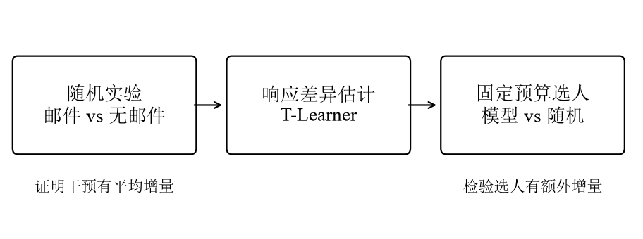

模型的作用是调整邮件发给谁。只有客户之间存在可利用的响应差异，而且模型能够识别这些差异，个性化选人才有机会提高预算收益。
如果所有客户的真实响应完全相同，邮件即使平均有效，按模型分数选人也不会比同等比例的随机触达获得更多新增购买。

本报告研究Hillstrom数据中的男装主题邮件。22个模型评分配置分别按5档预算评估，共得到110项比较，均未证实模型选人比同预算随机选人带来更多购买。
其中31项点估计为正，但证据仍不足以确认优势；同样，未检出优势也不意味着真实效果必然为零。Criteo使用另一套公开数据，其结果单独报告，Hillstrom的失败记录完整保留。

## 项目已有能力与本次分析范围

现有项目已能用SQL取数、分析总体实验效果、拟合基础增量模型，并评估固定预算策略。规则驱动的Agent把这些步骤连接起来，输出可追溯报告。
本次工作在此基础上补充模型诊断和业务判断，重点解释模型为何呈现当前结果，以及接下来应如何验证。不在本轮扩展通用NL2SQL、多Agent或自动投放。

项目可用于展示实验分析、增长数据科学和策略评估的思考过程。工具链是否完整、测试有多少，不能单独说明作者已能独立解决复杂业务问题。作者还需能解释方法与结论、指出相应代码，并完成合理修改。
本报告使用AI辅助编程与写作，所有数值均来自保存的程序结果。辅助工具完成的工作与作者已经掌握的能力需要如实区分。

# 增量的定义、识别条件与选人原则

## 先区分平均效果与策略效果

用$X$表示实验前特征，$T\in\{0,1\}$表示客户是否被随机分配到男装主题邮件组。
$Y(1)$和$Y(0)$分别表示该客户在有邮件、无邮件分配条件下，14天内是否购买。同一名客户只能经历一种分配，所以只能观察一个潜在结果。数据中没有可直接用于监督学习的“真实个体增量标签”。

将两种条件下的平均购买概率及其差异定义为：
$$
\mu_t(x)=E[Y(t)\mid X=x],\qquad
\tau(x)=\mu_1(x)-\mu_0(x).
$$
其中$\tau(x)$是具有相同特征的人群的平均响应差异，描述同类客户的平均差异，并非某名客户必然受益的个体真值。

邮件对全体客户的平均作用称为总体平均处理效果 $ATE=E[\tau(X)]$。
选人价值还取决于邮件发给谁。令$\pi(X)\in\{0,1\}$表示是否触达该客户，定义相对全部不发邮件的增量价值：
$$
G(\pi)=E[\pi(X)\tau(X)].
$$
完整策略购买率为 $E[\mu_0(X)]+G(\pi)$。
评估不同策略时，共同的无邮件购买率项相同，比较时可以抵消。
**所有策略价值都以全部符合条件并分配到策略的人群为分母，不以已触达客户或已购买客户为分母。**

## 固定预算下应如何选人

设触达比例为$E[\pi(X)]=q$。如果每次触达成本相同，目标又是增加购买人数，那么在真实$\tau(X)$已知时，应优先选择$\tau(X)$最大的客户。
原因是：只要某位已选客户a的效果低于未选客户b，把邮件机会从前者换给后者，就能在预算不变时增加期望购买。实际应用只有估计分数，后续评估要检验的正是这个估计排序是否有用。

随机选取比例q的客户时，增量价值为 $q\,ATE$。
模型相对这个随机基准的额外价值为：
$$
\Delta(\pi,q)=G(\pi)-q\,ATE
=E[(\pi(X)-q)\tau(X)].
$$
当 $E[\pi]=q$ 时，它也等于 $\operatorname{Cov}(\pi,\tau)$。
选人决定与真实响应越正相关，策略越有优势。购买预测AUC衡量的是另一种排序，不能代替这个判断。

一个教学例子可以说明区别。类型A客户无邮件时购买率为20%，有邮件时为22%，增量是2个百分点；类型B客户对应为2%和8%，增量是6个百分点。
如果预测谁更可能购买，会优先选A；如果希望邮件改变购买决定，应优先选B。这些数字仅用于解释原理，并非Hillstrom的实际结果。

## 随机实验支持什么因果解释

Hillstrom原始案例记录了三组随机分配和两周结果窗口。[1](#ref-hillstrom2008) 本报告按既定组别保留男装邮件与无邮件客户，在这两组内，实验设计给出的分配概率为0.5。
这个概率描述客户被分到哪组，购买分数描述客户是否会购买，两者用途不同。分析采用设计概率，而不用有限样本中略有偏差的实际组别比例代替。

把组间差异解释为因果效果，还需要随机分配与潜在结果独立、处理定义一致、客户间没有影响估计的干扰，以及结果记录完整。目标人群和邮件方案也必须明确。
未送达、跨渠道重复触达或客户间传播，都可能影响这些条件。由于缺少完整送达日志，本报告估计的是分配到邮件方案的意向治疗效果（ITT），而非实际打开邮件产生的效果。

分析只使用实验前特征，并保留全部分配客户作为分母。访问、购买和消费都是干预后的行为，按这些行为筛选会改变随机化形成的可比人群。实验组名表示邮件主题，不表示客户性别。

# 数据、分析方案与历史结果复现

## 评估中实际有多少购买事件

原始公开数据有64,000行。男装主分析保留男装主题邮件和无邮件两组，共42,613人；女装主题邮件另在附录分析。原文件SHA-256、查询参数、软件版本和只读核对记录均已保存。
完整历史建模人群中，男装邮件组21,307人、267次购买，无邮件组21,306人、122次购买。按分配组别比较的ITT差值为0.6805个百分点，95%区间为[0.5014, 0.8641]，支持这一历史邮件方案存在正的平均效果。
主分析方向是在查看过历史组别结果后确定的，因而不属于前瞻预注册检验。数据仅是历史实验快照，没有逐日结果时间戳，可分析的是既定结果窗口，不能据此还原任意窗口或动态购买过程。

样本划分和实际购买次数列于下表。[样本与事件数量图](#fig:events)分别画出人数和事件数，便于看清两者的数量级差异。

| 划分 | 实验组 | 客户数 | 购买数 | 购买率 |
| --- | --- | --- | --- | --- |
| 训练集 | 男装邮件 | 12,784 | 151 | 1.18% |
| 训练集 | 无邮件 | 12,784 | 73 | 0.57% |
| 验证集 | 男装邮件 | 4,261 | 61 | 1.43% |
| 验证集 | 无邮件 | 4,261 | 21 | 0.49% |
| 旧测试集 | 男装邮件 | 4,262 | 55 | 1.29% |
| 旧测试集 | 无邮件 | 4,261 | 28 | 0.66% |

*固定划分的样本与事件数量*

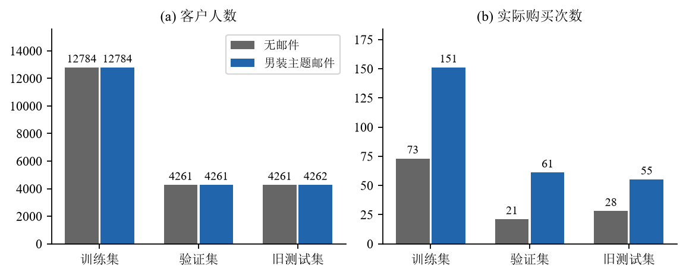

既有测试集虽来自64,000行公开数据，实际用于评估的购买事件只有83次。少量事件意味着策略估计可能有较大波动，但它只是精度的一个来源，尚不足以说明模型为何未能建立优势。

## 数据划分、特征与预算规则

分析沿用原客户级60%/20%/20%划分，种子为20261011。训练集用于拟合，验证集用于展示诊断，既有测试集用于探索性比较，不重新切分。“既有测试集”（表中沿用“旧测试集”）指此前已经被查看过的测试数据，因此不能再按全新未见样本解释。
使用的特征为recency、history_segment、history、history_band、mens、womens、zip_code、newbie和channel。编码、标准化及类别集合都只从相应训练数据学习，避免评估数据影响预处理。

执行新增分析前，先固定10%预算为核心比较，并完整展示5%、20%、30%、50%的补充结果。已看过数据这一事实不因此消失，所以分析仍属探索性。模型参数、预算、种子和结论判据均不根据既有测试结果调整。
每种策略都按分数从高到低选取round(qn)人，同分按固定客户顺序处理；即使分数为负，也按原预算选足人数。10%预算实际选中852/8523人，对应9.9965%。

## 先复现历史，再报告新增区间

重建逻辑回归后，mu0、mu1、uplift及合并购买预测四类分数与历史登记值的最大差异均小于$5\times10^{-9}$。差异与历史值保留八位小数的精度一致，说明模型重建结果与原记录相符。
原300次bootstrap也单独复现：逻辑回归相对事先固定随机名单的差值为0.0675个百分点，区间为[-0.1509, 0.2808]。

新增分析采用2,000次共同bootstrap，即反复从同一评估人群有放回抽样，并在每次抽样中一起比较各策略。原区间作为历史记录保留。
增加重抽样次数能减小bootstrap本身的数值近似误差，但样本和购买事件仍是原来那些，也不会使已被查看的测试集重新独立。

# 基础模型：分别预测两种条件下的购买

## 逻辑回归T-Learner

T-Learner分别学习邮件组和无邮件组的购买概率，用概率差作为增量分数：
$$
\hat\tau(x)=\hat\mu_1(x)-\hat\mu_0(x).
$$
这样把响应估计拆成两个常规预测问题，便于使用成熟算法，也便于分别诊断。[2](#ref-kunzel2019)
随机化支持两组结果均值的识别，但不保证在有限数据下能准确恢复细粒度的条件效果。

基础比较中的逻辑回归采用固定默认正则、标准化和独热编码，不搜索参数。其实现成本低，预测过程也便于检查。后文的扩展探索另有登记配置，两者分别解释。
T-Learner的困难在于，最终概率差同时包含两个结果模型的误差，而每组可用的购买事件又很少。逻辑回归在logit尺度上是加性的，转成购买概率后仍有非线性，因此不能简单称为完全线性模型。

## 用受约束树检验表达能力

新增候选是HistGradientBoosting T-Learner，使用基于直方图的梯度提升树表示非线性分割和特征交互。
参数事先固定为100轮、学习率0.05、最多7个叶节点、最大深度3、每叶至少200人、L2正则10，关闭早停和类别重加权。它与逻辑回归使用相同原始特征、划分和预算，仅把同样的编码结果转成稠密矩阵，以适配树模型输入。

比较要回答的是：在相同数据和这组约束下，增加表达能力能否改善购买概率预测，进而改善选人排序？本阶段只评估这一固定树候选，未搜索最佳树参数，也未运行因果森林。结果的适用范围因此限于当前配置。实现细节按所用scikit-learn版本的官方文档核对。[3](#ref-sklearnhgb)

另外保留普通购买概率排序和无邮件购买概率排序作为参照。合并购买模型利用历史随机混合分配下的数据估计购买倾向，输出既非组别分配概率，也非纯粹无干预时的自然购买率。
这些参照让比较更完整。某个预算下的测试点估计即使较高，也还需要独立证据，才能作为生产策略依据。

# 模型诊断：预测、排序与名单稳定性

## 购买概率是否估得更好

先检查两个结果模型能否比简单预测更好。简单基线对所有客户都输出相应训练组的平均购买率。Log Loss（对数损失）和Brier Score（概率平方误差）均衡量概率预测质量。
校准图则按预测概率分成五档，对照每档预测与实际购买率，并给出实际比例的Wilson区间。这里是在诊断概率，没有对模型重新校准；概率预测准确也并不直接意味着增量差值准确。[4](#ref-sklearncalibration)

| 模型与组别 | Log Loss | 常数基线损失 | Brier | 购买AUC |
| --- | --- | --- | --- | --- |
| 逻辑回归/无邮件 | 0.039264 | 0.039633 | 0.006534 | 0.6434 |
| 逻辑回归/男装邮件 | 0.069122 | 0.069008 | 0.012735 | 0.5549 |
| 受约束树/无邮件 | 0.039132 | 0.039633 | 0.006529 | 0.6447 |
| 受约束树/男装邮件 | 0.069358 | 0.069008 | 0.012740 | 0.5495 |

*旧测试集的结果概率预测诊断*

邮件组中，逻辑回归的测试Log Loss为0.069122，略高于常数基线0.069008；受约束树为0.069358。损失越低越好，因此当前树配置没有带来预期的预测改善。
无邮件组中，两模型损失都有小幅下降，但本轮未对这些微小差异另做模型优越性检验。购买概率的这点变化，也不足以确认响应差异已经估准。

[概率校准图](#fig:calibration)显示，各预测档位的观测比例区间较宽。[预测损失图](#fig:loss)进一步把相对常数基线的损失变化画在同一尺度，便于判断改善幅度。

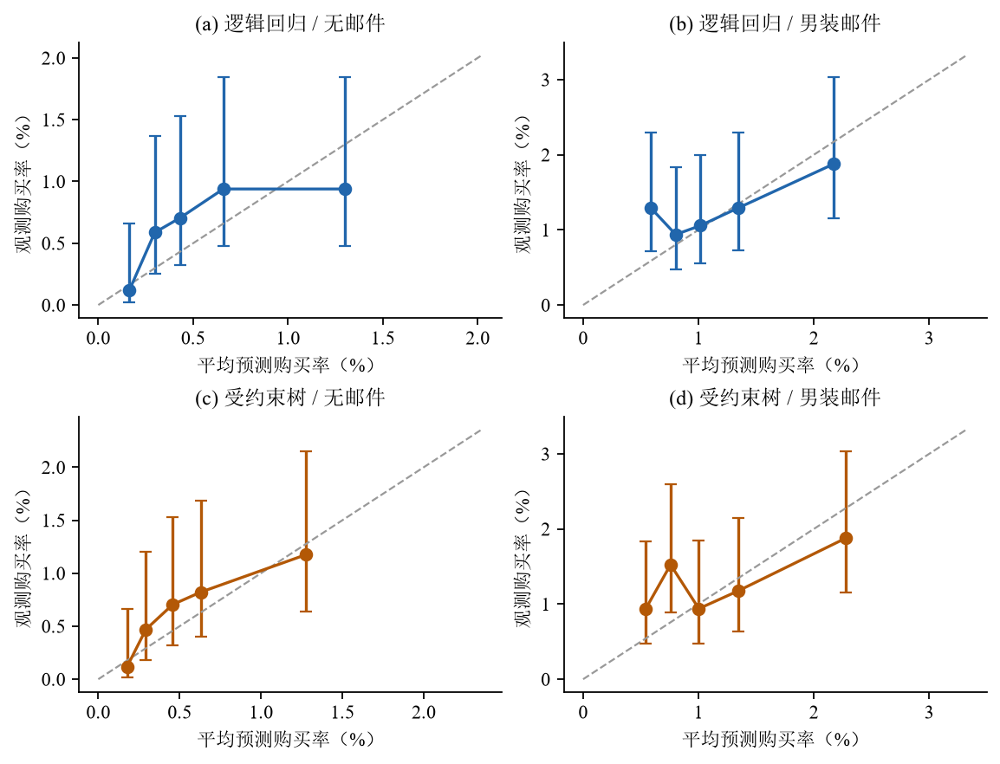

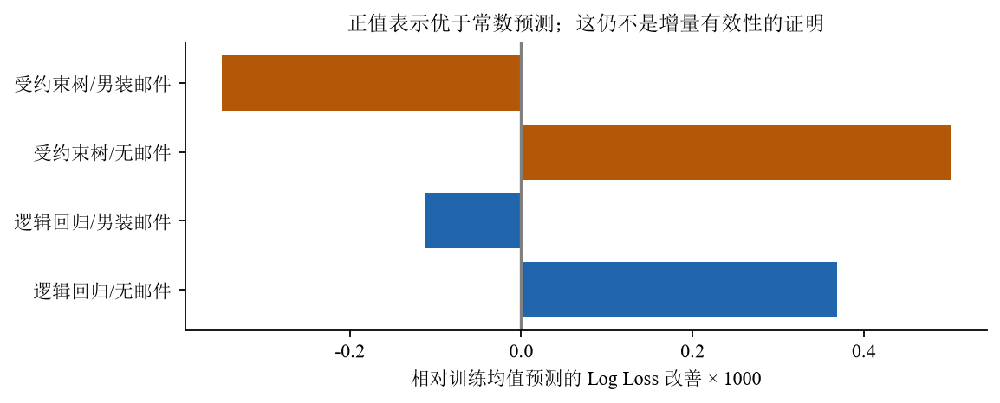

## 高增量分数是否对应更大的实际效果

[预测分数分布图](#fig:scores)展示模型估计的增量，而非已观测的个体因果效果。分布较宽说明模型给出了不同评分；负分数说明模型预测响应为负，尚不能据此认定某些客户实际会受到邮件伤害。

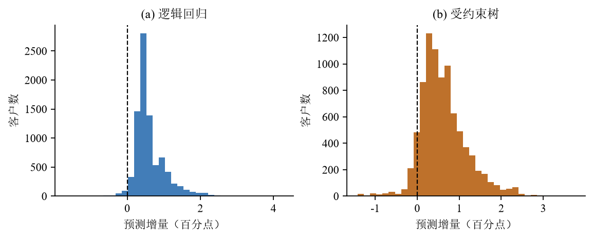

若排序有效，通常期望高分人群的邮件效果更大。为检查这一点，按模型分数从高到低把客户分为五档，划档时不使用评估样本的结果标签。每档内再比较随机分配的邮件组与对照组，并用Newcombe方法计算区间。[分层效果图](#fig:strata)展示全部档位。

| 模型/分档 | 干预/对照购买数 | 效果（百分点） | 95%区间 |
| --- | --- | --- | --- |
| 逻辑回归/Q1 | 15/13 | 0.1365 | [-1.1507, 1.4071] |
| 逻辑回归/Q2 | 7/8 | -0.0668 | [-1.0463, 0.9295] |
| 逻辑回归/Q3 | 14/4 | 1.1545 | [0.1677, 2.2783] |
| 逻辑回归/Q4 | 13/2 | 1.2828 | [0.3996, 2.3588] |
| 逻辑回归/Q5 | 6/1 | 0.5985 | [-0.0630, 1.4392] |
| 受约束树/Q1 | 18/7 | 1.2989 | [0.1408, 2.5754] |
| 受约束树/Q2 | 9/5 | 0.3996 | [-0.5444, 1.3659] |
| 受约束树/Q3 | 9/5 | 0.4740 | [-0.4502, 1.4730] |
| 受约束树/Q4 | 8/8 | 0.0728 | [-0.9209, 1.1118] |
| 受约束树/Q5 | 11/3 | 0.9351 | [0.0499, 1.9654] |

*探索性增量分层结果*

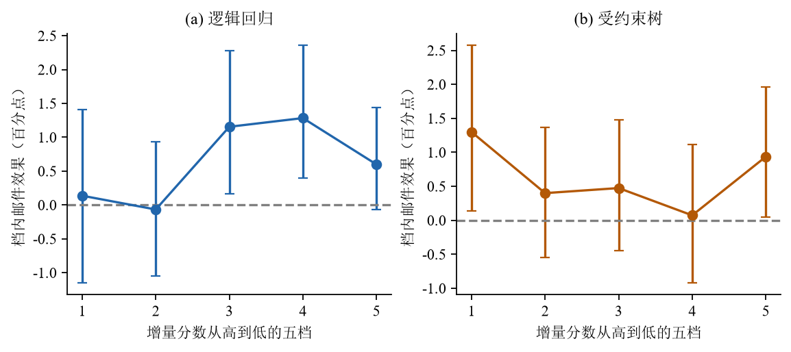

逻辑回归各档的实际效果没有随分数降低而清楚递减。受约束树最高档效果较大，但其他档位仍有波动，排序信号并不稳定。
某档区间排除0，说明的是该档邮件效果，而非它优于其他档位。这些分层结果只作探索性诊断，尚未完成正式的异质性或排名一致性检验。通用机器学习分组后的正式推断可参考相关文献，本轮未实现其完整检验。[5](#ref-imaili2024)

## 少量事件与训练变化如何影响名单

| 策略 | 名单人数 | 干预/对照人数 | 干预/对照购买数 | 名单内效果（百分点） |
| --- | --- | --- | --- | --- |
| 逻辑回归 | 852 | 428/424 | 10/6 | 0.9214 |
| 受约束树 | 852 | 431/421 | 10/4 | 1.3701 |
| 固定随机 | 852 | 422/430 | 3/2 | 0.2458 |

*10%预算名单的实际人数与事件*

在10%预算下，逻辑回归名单共16次购买，来自邮件组10次、对照组6次；固定随机名单共5次购买。每个事件都可能明显影响估计。
但“16比5”并不是新增11次购买。两份名单的客户风险不同，实际随机分配的构成也不同，需要用统一策略估计量比较，而不能直接减去观察购买数。

为了检验名单对训练数据的依赖，在每个实验组内做30次有放回重抽样。每组人数保持不变，购买次数可随抽样变化。两种算法使用相同抽样索引，每次都重新拟合预处理和模型。
[训练稳定性图](#fig:stability)展示评分及名单变化，[入选频率图](#fig:frequency)展示哪些客户反复入选。

| 模型 | 秩相关中位数 | 名单Jaccard中位数 | 曾入选人数 | 至少80%入选人数 |
| --- | --- | --- | --- | --- |
| 逻辑回归 | 0.650 | 0.418 | 3357 | 142 |
| 受约束树 | 0.611 | 0.321 | 4346 | 23 |

*30次训练扰动的稳定性诊断*

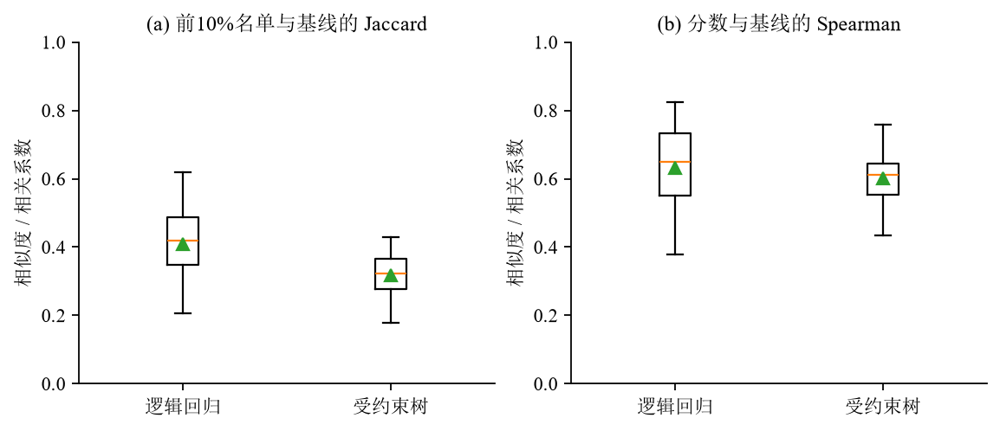

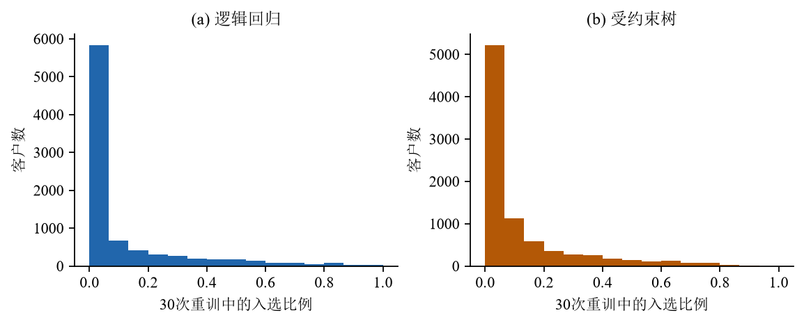

当前树模型的名单随训练样本变化更大，说明它在这组设定下更敏感。这个观察限于当前比较，既不足以概括所有复杂模型，也不能反推原模型一定欠拟合。
30次重训用于稳定性诊断，其策略值分布不作为总体置信区间，也没有从中挑选表现最好的一次作为最终模型。

# 策略评估：名单是否带来额外购买

## 原估计量与配对重抽样

原系统采用自归一化逆概率加权估计（SNIPS）。在分配概率为常数时，它等于名单内两组购买率差乘以名单占比：
$$
\hat G_{\mathrm{SNIPS}}(\pi)
=\hat q\left(\overline{Y}_{T=1,\pi=1}
-\overline{Y}_{T=0,\pi=1}\right).
$$
其中$\hat q$为实际名单人数占全部评估客户的比例。
它包含归一化比值，因此有限样本下通常不是严格无偏估计。
历史字段虽叫ips_estimate，实际计算仍是这里的SNIPS，而非未归一化Horvitz–Thompson估计量。

区间通过共同bootstrap计算：每次从评估客户中重抽一份样本，所有策略都使用这份样本，重新排名、按既定比例选人，再直接计算策略差值。共同抽样保留了策略估计之间的相关性，因此判断差异应看配对差值区间，而非各自区间是否重叠。
这个过程固定模型和排序规则，但没有固定原来852名客户的身份。它描述评估客户变化带来的不确定性，未覆盖重新训练和模型选择。

| 分析 | 固定内容 | 变化内容 |
| --- | --- | --- |
| 主bootstrap | 模型、预测、预算排序与并列规则 | 重抽评估客户，重新形成名单 |
| 训练稳定性 | 旧测试客户、结果、预算 | 训练样本、模型、评分与名单 |
| 功效模拟 | 经验人群、名单、结果预测及生成机制 | 处理分配与购买结果 |

*各分析固定与变化的对象*

后面的模拟固定名单，并使用正态近似区间。它检验的对象与此处重排名bootstrap不同，因此不能用模拟覆盖率来保证本节区间的覆盖表现。

## 用AIPW检查对结果预测的依赖

为用实际结果修正概率预测，另计算增强逆概率加权（AIPW）分数：
$$
\hat\Gamma_i=
\hat\mu_1(X_i)-\hat\mu_0(X_i)
+\frac{T_i}{e_i}\{Y_i-\hat\mu_1(X_i)\}
-\frac{1-T_i}{1-e_i}\{Y_i-\hat\mu_0(X_i)\},
\quad e_i=0.5.
$$
对名单内客户分数加总，再除以全部评估客户数，得到固定策略增量：
$$
\hat G_{\mathrm{DR}}(\pi)=\frac1n\sum_{i=1}^{n}\pi(X_i)\hat\Gamma_i.
$$
两种策略继续在同一批客户上作配对比较：
$$
\hat\Delta(\pi_a,\pi_b)
=\frac1n\sum_i\{\pi_a(X_i)-\pi_b(X_i)\}\hat\Gamma_i.
$$

AIPW用实际结果修正预测误差。给定独立训练的结果预测，若随机分配概率正确，处理组加权残差的期望补上$\mu_1-\hat\mu_1$，对照组则补上$\mu_0-\hat\mu_0$。两项修正加回预测差后，得到目标$\tau$。
因此，策略评估不必完全相信模型的概率差。不过，“双重稳健”有明确条件，不能修复任意数据问题，也不保证在购买稀少时方差更小。结果预测需在样本外取得，理论推断还要求相应正则条件。[6](#ref-dml2018)

开发集train+valid使用五折交叉拟合：每个人的结果预测由没有用到该人的模型生成，划折时按处理组和购买结果分层。这里计算开发集总体ATE，未对自适应学出的策略提供无条件推断。由于划折使用结果标签，折外预测并非严格有限样本独立；本报告采用常规渐近标准误，将其用于交叉拟合诊断，不主张精确覆盖。
既有测试集的结果预测来自五个开发集折外模型的平均，训练均未使用测试结果。这项固定策略分析依赖训练与评估结果隔离，与开发集的结果分层诊断分开解释，也不合并成一次新的独立验证。开发集AIPW ATE为0.6898个百分点，既有测试集为0.6245个百分点；人群和样本不同，不要求两值相等。

## 固定10%预算时，优势是否成立

| 估计量 | 10%预算策略差 | 差值（百分点） | 95%配对区间 |
| --- | --- | --- | --- |
| SNIPS | 逻辑回归−固定随机 | 0.0675 | [-0.1446, 0.2757] |
| SNIPS | 受约束树−固定随机 | 0.1124 | [-0.0767, 0.3256] |
| SNIPS | 受约束树−逻辑回归 | 0.0449 | [-0.1278, 0.2293] |
| AIPW | 逻辑回归−固定随机 | 0.0677 | [-0.1437, 0.2752] |
| AIPW | 受约束树−固定随机 | 0.1150 | [-0.0729, 0.3276] |
| AIPW | 受约束树−逻辑回归 | 0.0473 | [-0.1279, 0.2321] |
| AIPW | 逻辑回归−随机预算期望 | 0.0275 | [-0.1524, 0.1905] |
| AIPW | 受约束树−随机预算期望 | 0.0749 | [-0.0804, 0.2306] |
| AIPW | 购买预测−固定随机 | 0.1140 | [-0.0708, 0.3244] |
| AIPW | 逻辑回归−购买预测 | -0.0463 | [-0.2404, 0.1243] |
| AIPW | 受约束树−购买预测 | 0.0010 | [-0.1760, 0.1580] |

*10%预算的配对策略差值*

专门增量模型是否优于普通购买排序，需要直接比较。逻辑回归相对购买预测的AIPW差值为-0.0463个百分点，区间[-0.2404, 0.1243]；受约束树为0.0010个百分点，区间[-0.1760, 0.1580]。两者均未建立优势，目标定义更贴近干预决策并不自动意味着排序更好。
这些直接比较在第一轮审阅后由已有共同重抽样分布计算，属于新增探索性分析，不是原方案预注册的主要检验。

[配对策略差值图](#fig:contrasts)展示10%预算的AIPW结果。先看相对随机预算期望的优势，再看相对固定随机名单的历史对照。逻辑回归对后者的优势为0.0677个百分点，对前者为0.0275个百分点。
随机名单本身也有抽样波动，某一次名单的表现不能代表随机触达的平均表现。两种对照分别服务于历史复现和更稳定的预算基准比较。

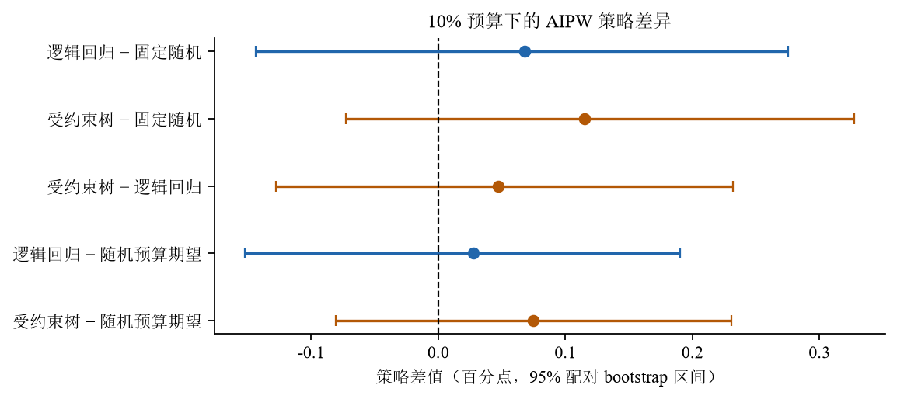

[预算与价值曲线](#fig:policycurves)展示全部五档预算，便于观察点估计随资源的变化。曲线最高点尚未经独立验证，不能据此宣布最优预算。不同预算消耗不同资源，比较全部触达与10%触达时，也必须考虑资源条件。

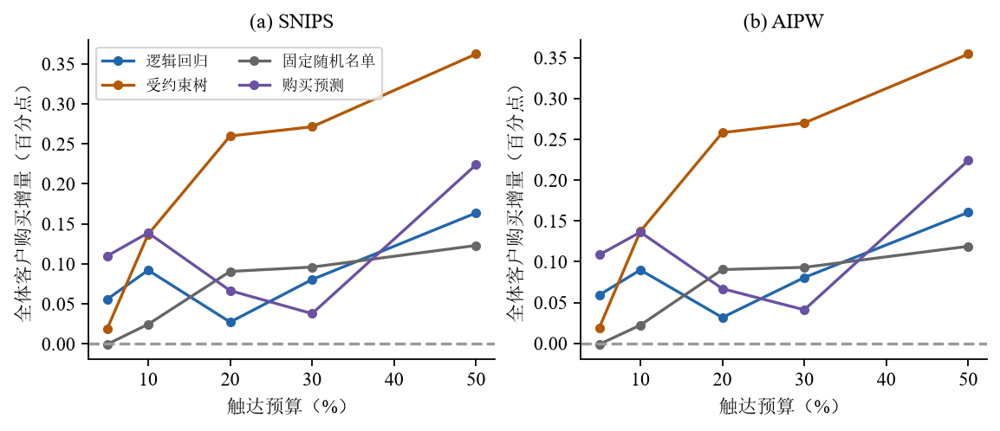

## 区间包含零后，能作什么判断

逻辑回归相对固定随机策略的AIPW区间宽0.4189个百分点，同时容纳损失和收益。在固定模型的当前探索性评估下，这些业务后果尚无法有效区分。
区间包含0并不说明策略完全相同，上界也不能当成预期收益。由于测试数据已被查看且呈现了多项结果，这些区间不为所有后续自适应选择提供确认性保证。

受约束树与逻辑回归的差值区间仍包含0，因此既不能确定非线性表达能力是唯一瓶颈，也不能认为换树模型已解决瓶颈。
购买事件少、概率预测改善有限、排序不稳定和区间宽，共同限制了可确认的策略收益。当前数据尚不能把这些因素的贡献逐项分开。

# 扩展探索：更多方法能否找到购买优势

## 扩展的目的与分析范围

首版完成后，用户要求扩大探索，目标仍是购买率优于同预算随机选人。因此另行保存扩展协议v2，扩大候选范围，同时保留基础比较的协议、结果和首次负结果。
扩展没有把购买改成更容易获得正结果的访问率，也不把后续方法追认成第一阶段预注册候选。两个阶段的范围和执行顺序分别记录。

扩展包含几种学习思路：T-Learner分别拟合两组，使用逻辑回归、梯度提升或随机森林；S-Learner共享结果模型并收缩处理交互；另有X-Learner，以及在DR伪结果上拟合的岭回归、受约束树、随机森林和浅分区。
共21个增量候选，另加一个合并购买预测基线。所有候选使用相同实验前特征，参数和清单在查看扩展测试结果前保存。DR森林只是对DR伪结果做回归的森林，未实现GRF或CausalForestDML。

## 共享信息、收缩与伪结果学习的作用

S-Learner让两组共享基础购买规律，再用处理项和收缩交互学习差异，希望减少完全分开拟合的方差。
无交互的共享逻辑回归在log-odds尺度估计共同处理项：
$$
\hat\mu_t(x)=\operatorname{sigmoid}\{f(x)+\beta(t-0.5)\}.
$$
即使没有特征与处理交互，概率差仍随基础风险$f(x)$变化，所以共同处理系数不意味着概率尺度上每人效果都相同。
这项约束可能降低方差，也可能错过真实响应机制。

为约束响应差异，把中心化处理项与特征的交互列分别乘以0.1、0.5或1，固定逻辑回归L2设置C=1。交互列越小，表示相同原尺度作用所需的系数越大，承担的L2惩罚也越大。这是在训练时加强收缩，并非训练后把预测增量乘以0.1，也不保证稳定性或真实效果一定更小。
X-Learner用跨组预测插补缺失响应，再学习处理差异。本实验两组接近平衡，不能预设不平衡数据下的优势会在这里出现。DR-Learner先生成样本外AIPW伪结果，再拟合其条件均值。伪结果提供学习目标，但不是观测到的个体真实增量，稀少购买仍可能使它噪声很高。

开发集采用保存的五折：用四折训练，在余下一折评分。DR候选的外层训练部分再做三折交叉拟合来生成伪结果，使结果模型不接触外层评估结果。
这层嵌套隔离了伪结果训练，并未另留最外层样本来独立评估完整选模程序。共享信息、收缩、非线性和伪结果学习，对应不同的偏差与方差取舍，实际价值仍由结果判断。

## 先在开发集选择，再完整报告测试结果

扩展开发集由原train+valid组成，共34,090人，所有新增候选最终均用这34,090人拟合，新逻辑回归基线也重新训练。相对基础比较的25,568人版本，训练规模和算法都可能影响结果，不能把变化全归因于算法。
模型配置和预算在开发集选择并固定，既有测试集不参与选择。

每个外层评估折重新按预算选人，用同一组折外AIPW分数计算相对随机预算期望的增量。在5%、10%、20%、30%、50%中，按开发集加权平均增量选出候选与预算组合形成短名单，另保留固定10%预算的选择。
跨预算比较只探索这些资源水平下的效果，并未优化利润。开发分数用于选择，不作为独立显著性验证；各折训练样本重叠，也不能把折数当成独立实验次数。

| 开发集选定配置 | 预算 | 开发集优势（百分点） | 旧测试优势及95%区间 | 同时区间 |
| --- | --- | --- | --- | --- |
| DR岭回归(1000) | 30% | 0.1141 | -0.2094 [-0.3935, 0.0034] | [-0.5459, 0.1271] |
| X提升树(叶500) | 20% | 0.1122 | -0.0660 [-0.2267, 0.1077] | [-0.3440, 0.2120] |
| DR深度2树 | 30% | 0.1120 | 0.0481 [-0.1429, 0.2527] | [-0.2894, 0.3855] |

*扩展开发集选择及旧测试结果*

在既有测试集完整评价22个配置与五档预算，共110个对照，短名单之外的结果也全部保留。
逐组合结果保存在CSV与JSON。
逐项计算的区间称为名义区间。为考虑同时查看许多结果，再以共同bootstrap中的最大标准化偏差构造全家族同时区间。
本节同时家族严格限定为22个评分配置×5档预算、各自相对同预算随机期望的110项差值。
候选相对购买排序或T-Learner的直接差值、第一阶段分层与其他估计量、模拟结果均不在该家族内。
令$j$为上述110个坐标，$b$为共同bootstrap重复，使用：
$$
s_j=\operatorname{sd}_b(\hat\Delta_j^{*(b)}),\qquad
c_{.95}=Q_{.95}\left[\max_{j=1,\ldots,110}
\left|\frac{\hat\Delta_j^{*(b)}-\hat\Delta_j}{s_j}\right|\right].
$$
同时区间为$[\hat\Delta_j-c_{.95}s_j,\hat\Delta_j+c_{.95}s_j]$，本次临界值为3.2757。
这是使用各坐标统一bootstrap标准差的最大标准化偏差法，没有在每次重抽样中重新估计标准误，因而不称为bootstrap-t。
该近似固定训练模型，处理有限家族的多次比较，未解决历史测试集重复使用、训练选择不确定性或同分边界的非光滑问题。

## 扩展后仍未确认正向选人优势

开发集跨预算首选为DR岭回归(1000)，预算30%。开发优势为0.1141个百分点，既有测试差值为-0.2094个百分点，名义区间[-0.3935, 0.0034]，同时区间[-0.5459, 0.1271]。测试结果未用于重选冠军。
固定10%预算时，开发集选出DR深度2树，既有测试差值为0.0126个百分点，区间[-0.1261, 0.1532]。开发集的正信号未稳定延续，可能涉及选择噪声、训练不稳定和样本差异，尚不能精确归因。继续尝试直到显著，也无法代替可信验证。

全部结果中，31项点估计为正，0项名义区间下界大于0，0项同时区间下界大于0。负方向同样报告：79项点估计为负，5项名义区间上界小于0，0项同时区间上界小于0。
这些计数描述同一轮探索，不是独立实验成功率。单个最好点值或名义负值也不是确认性发现。相对不发邮件的策略价值另有保存，但不能替代同预算优于随机选人的目标。

相对普通购买排序，跨预算首选DR岭回归（alpha=1000）在30%预算下的直接差值为-0.0782个百分点，名义配对区间[-0.2519, 0.1449]。固定10%的DR深度2树为0.0062个百分点，区间[-0.2191, 0.2116]。这些额外直接比较不在110项随机基准差值的同时区间家族内。

固定10%首选在测试中仅有4种分数。预算边界的同分组共2,791人，384人进入852人名单，约占45.1%。在30%预算下，同一模型选中2,557人，其中2,089人来自该边界组，约占81.7%。
这更接近粗分层后按并列规则选人，不能解释为精细的个体因果排序。当前同分按保存快照的固定行序处理；未来应预先登记稳定客户键或抽签规则，与模型一起冻结。另一张边界名单可能产生不同点值，不能看过结果后挑有利种子。
普通购买排序若已捕获相近决策信号，就应承认专门增量模型的额外复杂度尚未得到支持。后续判断需结合开发选择、测试不确定性、完整尝试和业务约束。

## 全部配置的结果与解释

下表汇总全部22个配置，每行对应相同五档预算。完整110项点值、名义区间、同时区间、名单人数和事件数保存在results/exploration/all_test_results.csv，可逐项核对。

| 配置（每行5预算） | 正点数 | 点估计范围（百分点） | 名义正/负 | 同时正/负 |
| --- | --- | --- | --- | --- |
| T逻辑回归 | 0 | -0.2354至-0.0413 | 0/1 | 0/0 |
| T提升树/叶100 | 0 | -0.0950至-0.0414 | 0/0 | 0/0 |
| T提升树/叶200 | 1 | -0.1342至0.0796 | 0/0 | 0/0 |
| T提升树/叶500 | 3 | -0.0950至0.0711 | 0/0 | 0/0 |
| T随机森林/叶100 | 0 | -0.0762至-0.0375 | 0/0 | 0/0 |
| T随机森林/叶500 | 1 | -0.0912至0.0289 | 0/0 | 0/0 |
| S共享逻辑回归 | 2 | -0.1764至0.0607 | 0/0 | 0/0 |
| S交互缩放0.1 | 2 | -0.1714至0.0581 | 0/0 | 0/0 |
| S交互缩放0.5 | 1 | -0.1895至0.0331 | 0/0 | 0/0 |
| S交互缩放1 | 1 | -0.1976至0.0299 | 0/1 | 0/0 |
| S提升树 | 1 | -0.0781至0.0340 | 0/0 | 0/0 |
| X提升树/叶200 | 1 | -0.1130至0.0239 | 0/0 | 0/0 |
| X提升树/叶500 | 0 | -0.0830至-0.0179 | 0/0 | 0/0 |
| DR岭/alpha1 | 1 | -0.2364至0.0083 | 0/1 | 0/0 |
| DR岭/alpha100 | 1 | -0.2125至0.0071 | 0/1 | 0/0 |
| DR岭/alpha1000 | 1 | -0.2094至0.0101 | 0/1 | 0/0 |
| DR提升树/叶500 | 2 | -0.0839至0.0780 | 0/0 | 0/0 |
| DR提升树/叶1000 | 2 | -0.0994至0.0642 | 0/0 | 0/0 |
| DR回归森林 | 1 | -0.1360至0.0857 | 0/0 | 0/0 |
| DR深度1树 | 4 | -0.0135至0.0695 | 0/0 | 0/0 |
| DR深度2树 | 4 | -0.0542至0.0481 | 0/0 | 0/0 |
| 购买概率基线 | 2 | -0.1312至0.0818 | 0/0 | 0/0 |

*主分析全部评分配置的五预算汇总*

[完整110项点估计图](#fig:all110)同时展示正负点值。颜色只描述点估计方向和大小，不能代替显著性判断。

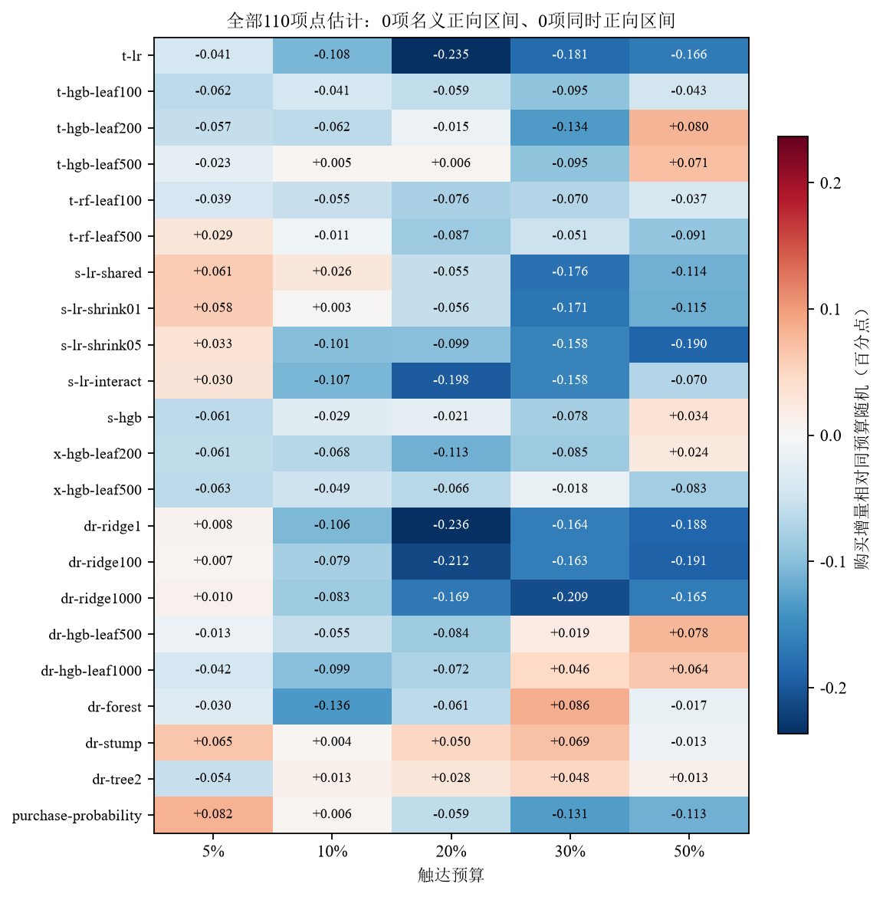

## 为什么没有检出优势：已有线索与缺口

从学习端看，基础T-Learner要用有限事件拟合两条购买概率曲面，再相减。男装既有测试共83次购买，10%原逻辑回归名单中16次，估计容易受少量事件影响；但83次本身不足以确定失败原因。
更直接的线索是邮件组损失未优于常数、分层没有清楚递减、重训名单Jaccard较低。这些检查仅对应第一阶段25,568人训练的逻辑回归和单个受约束树，未对扩展阶段34,090人训练的全部22配置重复概率损失、分层和30次重训。
因此它们不能作为全部110项未证实结果的统一根因，也无法区分真实异质性弱、当前特征不足或方法不适合各占多少。

从评估端看，在许多候选中选取最高开发分数，会引入选择噪声。跨预算首选在测试中由正变负，说明信号未稳定延续，尚不能精确归因为过拟合，更不能倒过来用测试结果重选模型。
多重比较和已看过的测试集限制了确认性解释，但不是校正抹去了一个已明确的正效果：逐项名义区间也没有显著正值。增加bootstrap次数只改善数值近似；换种子、预算或分母都不增加真实购买信息。

未检出优势后，还需看是否排除了业务关心的收益。固定10%开发首选的名义区间上界约0.1532个百分点，同时区间上界约0.2441个百分点，仍包含0.05个百分点这一设计情景。
所以现有证据既不足以承诺正收益，也不足以排除这种幅度的潜在收益。下节模拟只检查预设真值下的检出能力，不反推真实业务一定存在正效果。

# 用已知真值检查估计与检出能力

## 模拟要回答的两个问题

模拟固定既有测试集的实验前特征作为经验人群，基础购买概率取自仅用训练集拟合的逻辑回归对照模型。随后重新生成处理分配和二元购买结果，真实结果标签不作为模拟真值。
平均邮件效果设为历史样本差值，再人为改变真实响应异质性。这能检查给定场景下的估计表现，但不是对真实响应分布的估计。

为使策略优势成为已知量，令z表示固定模型选中的前10%人群，$q_n$为实际名单比例，构造：
$$
\tau_i=b+a(z_i-q_n),\qquad
a=\frac{\delta}{q_n(1-q_n)}.
$$
这里b固定为历史总体组差；$\delta$预先取0、0.02、0.05、0.10、0.20个百分点。
由此 $E_n[\tau_i]=b$，且模型名单相对随机预算期望的真实优势恰为$\delta$。
所有生成概率均检查落在[0,1]内，不通过截断改变真值。
设计有意让真实优势集中在模型所选人群。它回答假如该排序确实有效，现有样本能否检出相应幅度；不检验训练过程能否学会这种排序。

估计量核对另设零效果、恒定效果和异质性场景，分别搭配正确和刻意失配的结果模型，检查已知分配概率下的AIPW ATE。每种组合模拟500次，功效场景各模拟1,000次。所有场景执行前固定，结果完整保留。

| 真值场景 | 结果模型 | 平均误差（百分点） | 误差MCSE（百分点） | 覆盖率 |
| --- | --- | --- | --- | --- |
| zero | oracle | -0.0075 | 0.0079 | 93.40% |
| zero | misspecified | -0.0011 | 0.0072 | 95.80% |
| constant | oracle | 0.0003 | 0.0089 | 95.60% |
| constant | misspecified | -0.0037 | 0.0090 | 96.40% |
| heterogeneous | oracle | 0.0138 | 0.0093 | 95.00% |
| heterogeneous | misspecified | -0.0107 | 0.0093 | 93.80% |

*已知真值下的AIPW估计量核对*

## 若优势存在，当前样本有多大机会检出

| 真实优势（百分点） | 拒绝率 | 拒绝率MCSE | 覆盖率 | 模拟次数 |
| --- | --- | --- | --- | --- |
| 0.00 | 5.20% | 0.70% | 94.80% | 1000 |
| 0.02 | 6.30% | 0.77% | 94.40% | 1000 |
| 0.05 | 9.40% | 0.92% | 95.50% | 1000 |
| 0.10 | 23.20% | 1.33% | 94.20% | 1000 |
| 0.20 | 61.10% | 1.54% | 93.20% | 1000 |

*固定名单场景下的模拟拒绝率与覆盖率*

在本节固定人群、固定名单和生成机制下，真实额外优势即使达到0.10个百分点，检出概率仍只有23.20%，见[模拟检验力图](#fig:power)。
0优势时拒绝率为5.20%，接近名义5%，但有Monte Carlo误差。0.20个百分点场景下覆盖率为93.20%，低于名义95%，说明稀少事件下正态近似可能不够理想。报告保留这一偏差，没有通过换种子或补跑来改善呈现。

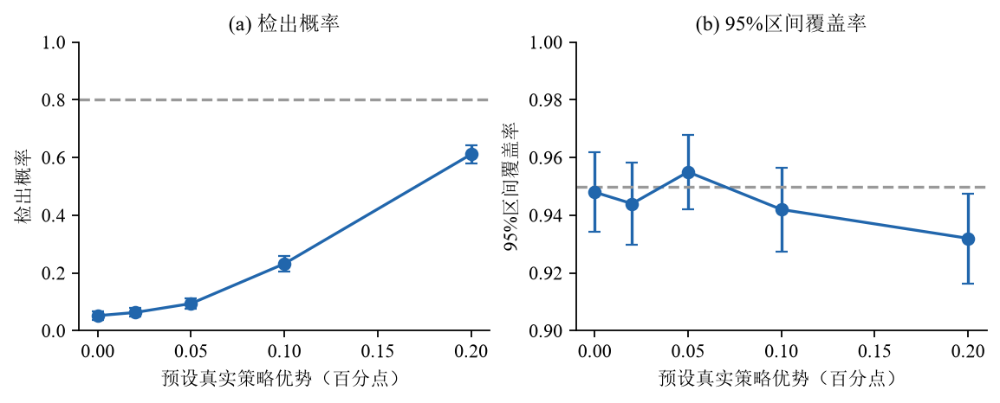

模拟的基准是同预算随机选择期望，不是既有测试中那一张随机名单。它使用AIPW分数的正态近似区间，也未直接验证前文配对bootstrap的覆盖率。
检出概率因此只属于当前场景，不是所有离线方法的通用功效，更不能用来认定实际存在某个大小的优势。这里也未根据观察到的模型差值反算事后功效。

# 下一轮实验与业务决策

## 当前证据支持怎样的行动

历史数据对邮件平均效果提供正向证据，但个性化排序的额外价值尚未证实。当前不足以仅因树模型点估计更高就替换默认策略或承诺收入提升。
若业务本来就需发邮件，可用随机触达作为清楚的比较基准，再按实施成本决定是否开展新的策略实验。

下表区分本轮候选与当前行动，避免把开发集首选直接理解为上线推荐。

| 用途 | 规则与当前判断 | 后续行动 |
| --- | --- | --- |
| 固定10%资源 | 开发集选择DR深度2树；同预算优势未证实 | 待验证，须先冻结稳定并列键 |
| 跨预算探索 | 开发集首选DR岭回归1000、30%；旧测试为负 | 保留负结果，不直接当10%方案 |
| 普通购买参照 | 同开发集训练、同预算配对比较 | 不以理论合理代替实证胜出 |
| 当前业务行动 | 无足够证据为个性化收益而替换 | 结合既定需求、样本容量和模型成本 |

*预算、候选与当前行动的对应关系*

未来10%实验仍需正式选定并固定候选；固定资源情景可从开发集10%选择流程产生的DR深度2树继续论证，并先解决稳定并列键。
这与跨预算30%首选是不同方案，历史默认逻辑回归也不是本轮开发首选。
下一轮随机实验比较两种策略：客户先被随机分配到模型策略组或随机策略组，再在各组内部选取10%客户触达。
模型及其特征、训练版本、预算和并列规则必须在分组前冻结。
两个策略组中未被选中的客户依旧参与主要指标分母。
这样比较的是完整选人规则，保留随机分组的可比性，避免只比较实际触达者产生选择偏差。

模型策略组和随机策略组已足以估计选人规则的额外价值。若还要同轮独立估计邮件总体增量，可增加无邮件对照，但需重排资源和样本量，不属于本轮已计算的两策略方案。

## 需要多少客户，现有资源是否足够

未来实验以14天购买率为主要指标，双侧显著性水平设为0.05，分别计算80%和90%检验力所需人数。检验力表示：预设优势确实存在时，实验有多大概率检出它。
随机策略基准购买率暂代入0.64%，计算为“无邮件购买率+10%×历史平均邮件效果”。这只是设计参数，不是已知未来真实基准；另用0.3%和1.0%检查敏感性。

样本量采用独立两比例正态近似，并用5,000次二项模拟核对预期检验力，方法与参数见官方文档。[7](#ref-statspower)
这是初步设计，未加入聚类、跨客户干扰、跨期重复或流失膨胀。模拟也只检查两比例近似，未重现精确选人配额、客户异质性和送达过程，因而不是完整策略实施机制的功效验证。

| 假设优势（百分点） | 目标检验力 | 每策略组人数 | 总人数 | 模拟检验力 |
| --- | --- | --- | --- | --- |
| 0.02 | 80.00% | 2,536,702 | 5,073,404 | 80.24% |
| 0.02 | 90.00% | 3,395,931 | 6,791,862 | 89.42% |
| 0.05 | 80.00% | 415,045 | 830,090 | 80.12% |
| 0.05 | 90.00% | 555,629 | 1,111,258 | 90.46% |
| 0.10 | 80.00% | 107,529 | 215,058 | 80.28% |
| 0.10 | 90.00% | 143,951 | 287,902 | 90.04% |

*未来两策略实验的近似样本量*

[未来实验样本量图](#fig:samplesize)显示，若目标是检出0.05个百分点总体优势，历史代入情景下达到80%检验力约需830,090名客户。这很可能超出个人项目可募集规模，设计了实验不等于已完成线上验证。
若总容量仅10万客户，同一情景下80%检验力对应的最小可检优势约0.1491个百分点。对0.05个百分点目标，现有容量不足。业务可先验证流程、延期确认性比较，或在确实认可更大最小差异时调整目标；未显著仍不能判作无收益。这些是审阅后补充的设计分析，尚未实施。

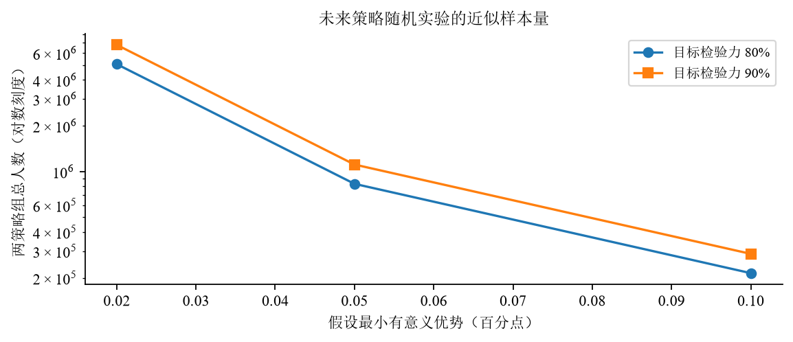

## 在实验前确定指标与停止规则

实验前需固定主要比较、主要指标、业务认可的最小有意义优势和样本量。等待每名客户完整14天结果窗口成熟，并在既定样本量达到时统一分析，不依据中间p值提前停止。
若需要连续监测，需另行设计统计方案，而非继续使用固定样本量判据。

未来还需记录分配、实际发送、送达、退订和跨渠道重复触达，这些日志不在当前Hillstrom数据中。主要分析按策略分配采用ITT口径。
若家庭或门店等单位存在明显干扰，就需改变随机化单位和样本量计算，不再机械假定客户彼此独立。

结果未显著时，应看区间能否区分业务关心的后果。同时包含有意义收益和损失，意味着证据不足。若要判断等效或排除值得关心的收益，需事先提出相应假设和精度要求。
结合收益阈值、风险和资源，统计结果才能支持具体行动。

## 成本未知时，怎样讨论经济性

购买增量是否值得实施还取决于价值和成本。当前缺少毛利、触达成本和订单价值，因而不估计实际利润。
设“每名增量购买客户价值v”和“每次触达成本c”为教学情景，净增量价值按每名分配客户计算：
$$
N(\pi)=vG(\pi)-cq.
$$
例如使用v为10、30、100，c为0、0.01、0.1的假设网格，金额单位沿用未命名的原金额单位。
情景结果保存于结构化文件，不把假设值写成真实企业成本。

同预算、同单次触达成本下，两策略成本项相同：
$$
N(\pi_a)-N(\pi_b)=v\{G(\pi_a)-G(\pi_b)\}.
$$
在相同预算下，降低共同触达成本不会改变选人优势的统计证据。
模型开发、维护、部署及风险控制等额外成本仍需单独计入。
若预期覆盖N名客户、额外模型成本为K，忽略其他差异时，至少需要v×N×Δ超过K才有经济动机；还应考虑效果不确定性与风险。
业务最小有意义优势应按这些条件讨论，而非选择容易显著的幅度。
若不同客户成本或购买价值不同，则应估计价值加权的响应并重新定义预算约束；本轮没有实现这类收益最优化。

# SQL与Agent如何支持分析

## SQL保持客户粒度与正确分母

Hillstrom按实验分配客户分析，而不是按访问或购买记录分析。取数从完整分配人群出发，检查客户唯一性、结果完整性和特征的决策前可用性，再以独立Python计算核对组别人数及结果。
本轮原5432业务库强制只读，分析仅保存快照，未登记生产模型或改变历史运行记录。

原项目的RetailHero多表处理可用于讨论关联膨胀、交易金额重复和特征截点。它是另一项工程材料，不是本轮增量结论的第二个随机实验，也不能与Hillstrom拼接对照。本轮未新增SQL性能基准，亦未重新核验RetailHero全量数据。

## Agent组织流程并保存分析证据

产品主流程由规则解析请求，形成结构化计划，再由程序路由调用工具。LangGraph保存状态并组织流程，LLM可辅助表达澄清措辞，最终数值结论不由自由生成的解释决定。
因此，当前实现适合称为可追溯的数据科学工作流，尚不是通用多Agent协作系统。

工程流程检查请求条件、阻止错误分母、统一指标口径并保存工具证据；超出能力的请求给出明确限制。这使分析可执行、可检查，但不能增加策略本身的统计证据。
本轮诊断和实验设计保存在独立脚本与报告中，尚未接入产品工具接口，后续可以这些计算产物为基础集成。

此前产品验收的889项测试仍是历史工程证据，本轮没有重新执行全部产品套件，也不用该数量代替新增分析验证。本轮同样未调用DeepSeek，因此没有新增API成绩或自动化效率比较。

# 综合判断与研究局限

## 把未证实结果转为可检查的解释

| 待检查的解释 | 本轮观察 | 可以得出的判断 |
| --- | --- | --- |
| 事件太少导致区间宽 | 测试83次购买；固定随机名单5次 | 精度受限，不能证明它是唯一原因 |
| 基础结果模型缺乏预测信号 | 干预组损失未优于常数基线 | 当前设定的预测改善有限 |
| 模型表达能力不足 | 新候选未建立配对策略优势 | 未证明加复杂度能解决问题 |
| 选人排序不稳定 | 重训名单Jaccard较低 | 需谨慎解释单次名单 |
| 真实响应完全同质 | 分档效果波动且区间宽 | 无法据此证明无异质性 |
| 只换评估量即可改善决策 | AIPW与SNIPS结论接近 | 新估计量未创造收益证据 |

*模型表现的证据诊断*

当前项目能够清楚定义增量并执行估计，但尚未证实个性化排序的额外业务价值。基础两模型的诊断显示：结果预测改善有限，分层效果波动，重训名单变化明显；评估购买事件又少，预设模拟中的检出能力有限。
这些是对当前证据分辨能力的解释，不是数据中不存在有用异质性的证明。扩展22配置另有开发选择和完整测试结果，但未重复所有校准、稳定性诊断，不能推定它们具有相同的失败机制。

## 推断和推广仍有哪些限制

新增比较使用同一份已被查看的历史测试集，整体按探索性解释。登记候选虽然较多，仍只是有限方法，未建立优势并不说明所有增量方法都无效；基础受控比较与后续探索也需分开。
配对bootstrap固定训练模型和结果预测，未覆盖训练、选择及采集的全部不确定性。扩展110项相对随机基准的同时区间只覆盖登记家族，基础比较、直接方法差值和历史自适应过程没有统一确认性保证，分层图也不是正式异质性检验。
模拟人为设定效果并固定名单，只检查给定条件下的估计表现，不验证模型能学到真实响应。数据来自2008年，客户、邮件和渠道与未来业务可能不同。购买与利润也不等价，经济情景不能当作已经实现的收益。

## 下一步优先补什么证据

优先选择独立新数据验证固定策略，或在真实业务中先确定最小可接受收益和实验预算。当前更需要理解已有结果及其适用范围，而非继续增加算法名称。
若能补充数据，应优先收集决策前可取得、且有业务机制支持响应差异的特征，再评估隐私要求和实际可用性。

后续接入Agent时，先将诊断和实验设计封装为经验证工具，再评估是否减少人工步骤、阻止错误并保存完整证据。更复杂的模型或新增编排框架，本身不能替代数据科学成果。

# 面试讲解与复现

## 需要能独立解释的判断

1. **为什么分母不能只取已触达或已购买客户？** 因为目标是策略分配产生的总体效果；对干预后的行为作筛选会改变可比人群。
2. **邮件平均有效，为什么模型可能无用？** 平均效果只说明干预的总体作用；额外排序收益依赖模型选择与真实响应差异的关联。
3. **为什么AUC不能证明uplift有效？** AUC对应购买预测的排序，不对应$\mu_1-\mu_0$或固定预算策略价值。
4. **T-Learner怎样工作，难点在哪？** 两个结果模型取差；单组事件稀少时，差值同时承受两侧估计误差。
5. **为什么增加树模型？** 检验一个具体的表达能力假设，而非寻找测试集上最好的算法。
6. **为什么用配对bootstrap？** 两个策略在同一批客户上评价，估计量相关；需保持共同重抽样，并直接构造差值。
7. **bootstrap没覆盖什么？** 本轮没有重训，因而不覆盖完整学习流程；训练稳定性另行诊断。
8. **AIPW为何不只是相信预测？** 它使用已知随机分配概率加权实际结果残差，修正结果模型误差。
9. **不显著后怎么办？** 看区间、业务阈值、风险和后续实验成本，不能自动判等效或继续调参直到显著。
10. **没有新数据怎样诚实报告？** 保留探索性标签、全部比较和失败记录，冻结下一轮方案，将真正独立验证留给新数据。

## 从分析问题找到对应代码

可按分析职责阅读代码：research_core.py实现选人、AIPW、SNIPS、配对bootstrap和样本量；run_study.py负责只读取数、训练、开发集交叉拟合、稳定性与模拟；make_figures.py读取保存结果绘图，compose_report.py生成表格，build.ps1负责排版。
例如解释“为什么名单有852人”，应能从预算取整追到实际分母、策略值和报告单位，形成可检查的计算过程，而不只介绍算法名称。

实现中出现过系数导出步骤名错误和重抽样并列顺序问题，失败日志与修复验证均保留。第二轮审阅还发现基线脚本重复追加，产生115行结果却只有110列抽样矩阵，导致越界。
修复后先读取21候选原始快照，再构建22配置结果，并检查候选预算键唯一性及矩阵维度。测试子进程显式固定研究目录；实际连续运行两次后，所查五个输出文件哈希相同，涵盖最终JSON、开发选择JSON、两张CSV和含基线测试分数Parquet。
这些是实际排错记录。结果重算与报告编译有不同入口，默认编译既不训练，也不覆盖图表。

## 证据文件和运行范围

| 材料 | 用途 |
| --- | --- |
| protocol.json | 执行前固定的本轮方案 |
| results/ | 预测、策略、稳定性、模拟和实验设计数值 |
| sources/ | 只读数据快照、客户划分、历史分数、折外预测和重抽样分布 |
| analysis/ | 独立计算、绘图、报告生成与验证脚本 |
| logs/ | 测试与实际错误修复记录 |
| reviews/ 与 versions/ | 三轮面试官反馈、修订回应和报告版本 |
| protocol_expansion_v2.json | 有限模型、预算、选择与推断家族登记 | 
| results/exploration/development_selection_with_benchmark.json | 含购买基线的开发选择及完整调参分数 | 
| results/exploration/all_test_results.csv | 全部110项旧测试结果 | 
| results/exploration/family_bootstrap_with_benchmark.npz | 共同配对分布与有限家族同时区间 |

*本轮材料与用途*

本报告保留MD、TeX、PDF及图表源码。重训和模拟需显式运行研究脚本，文字更新仅走报告生成与LaTeX构建。本轮新增材料均在项目内，历史数据、冻结验收证据和产品默认模型保留原样。
原实证分析已完成三轮独立面试官审阅，反馈、回应及v1至v4保存在reviews和versions。第三轮数值核对覆盖男装与女装220项，未要求重训；本版仅改进叙述与阅读体验。

# 附录：女装主题邮件的另行探索

男装结果已知后，按用户继续探索的要求，对同一CSV中的女装主题邮件与无邮件组另作分析。它共享无邮件客户，不是独立新数据或前瞻复制。
该部分单独包含110项组合，不计入男装主分析的110项。两个家族分别登记，未主张220项共同受到确认性控制。

女装开发集34,154人、测试集8,539人，测试实际购买62次，其中女装34、无邮件28。110项中41项点估计为正，0项名义正向区间，0项同时正向区间，仍未建立同预算优于随机选人的证据。
其余69项点估计为负，3项名义负向区间，0项同时负向区间。男装与女装分析共享全部4,261名测试对照客户。

| 副分析开发选择 | 预算 | 旧测试差值（百分点） | 名义95%区间 |
| --- | --- | --- | --- |
| T逻辑回归 | 50% | 0.0171 | [-0.1542, 0.1958] |
| S提升树 | 10% | -0.0616 | [-0.1954, 0.0718] |

*新增女装副分析选择与结果*

副分析沿用14天购买指标，以全部分配客户为分母，使用相同候选和五档预算，选择只依据本副分析开发集。协议、对照重建一致性、折外分数、选择及完整负结果保存在substudies/womens。
Womens E-Mail表示女装主题邮件，而非只向女性发送；分析未通过性别筛选寻找更好结果。

# 结论

本研究以随机实验为基础，先用T-Learner估计客户响应差异，再按预算形成名单，最后用实际结果检验策略价值。基础比较未确认模型选人优于随机，也未确认受约束树优于逻辑回归。扩大方法探索后仍未建立正向选人收益，开发首选在既有测试中的点估计反而为负，目标尚未实现，所有尝试和负结果均保留。
诊断进一步说明了证据的限制：有效事件少，基础两模型预测质量有限，分层及训练排序不稳，预设场景检验力不足。这些检查帮助理解结果，但没有确定所有扩展模型失败的共同原因。

尚不能确认收益时，分析仍需给出有证据的解释和可检验的下一步方案。本报告据此提出新的策略随机实验，并说明样本容量与经济假设如何影响决策。
SQL和Agent使这套分析能够执行、核对和交付；最终是否产生额外购买，仍须由与目标一致的实验和评估判断。

# 资料来源与阅读范围

原分析使用Consensus和SciSpace检索方法文献，再以原始论文、作者材料或官方文档核对关键内容。数据库摘要与年份不直接替代出版元数据。下表保留各来源的实际阅读范围，全文链接可访问并不表示已经逐页通读。

| 编号 | 资料 | 实际读取范围 |
| --- | --- | --- |
| 1 | [Hillstrom挑战获奖原始分析（2008）](https://stochasticsolutions.com/pdf/HillstromChallenge.pdf) | 已读取数据设计与方法相关正文；未逐页复核全部结论 |
| 2 | [Künzel等：Metalearners（PNAS，2019）](https://doi.org/10.1073/pnas.1804597116) | 核对论文身份、摘要及出版元数据；PMC全文受验证码限制 |
| 3 | [scikit-learn：HistGradientBoostingClassifier](https://scikit-learn.org/stable/modules/generated/sklearn.ensemble.HistGradientBoostingClassifier.html) | 已读取官方参数说明 |
| 4 | [scikit-learn：Probability calibration](https://scikit-learn.org/stable/modules/calibration.html) | 已读取相关官方说明 |
| 5 | [Imai与Li：通用ML异质性推断（2024修订版）](https://arxiv.org/html/2203.14511v3) | 已读取相关方法正文；未实现其完整检验 |
| 6 | [Chernozhukov等：Double/Debiased ML](https://arxiv.org/html/1608.00060v7) | 已读取正交分数、交叉拟合相关正文 |
| 7 | [statsmodels：NormalIndPower.solve_power](https://www.statsmodels.org/stable/generated/statsmodels.stats.power.NormalIndPower.solve_power.html) | 已读取官方方法接口 |
| 8 | [GRF官方方法说明](https://grf-labs.github.io/grf/articles/grf_guide.html) | 已读取AIPW、策略评价与分层诊断部分 |

*资料来源与实际阅读范围*
