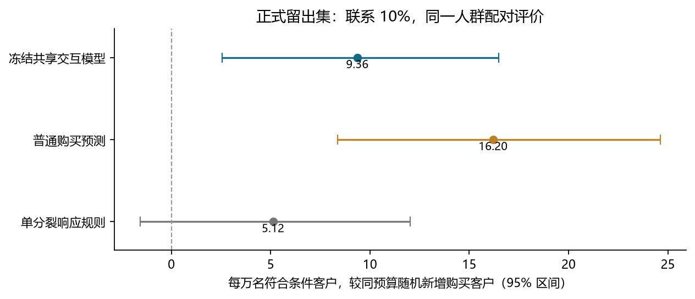
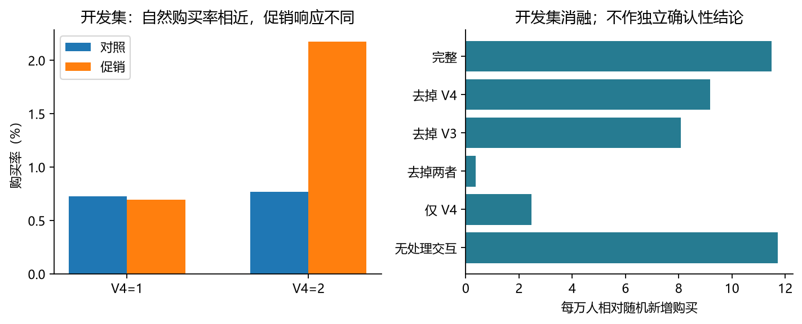
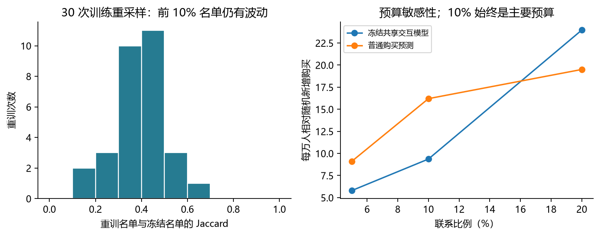
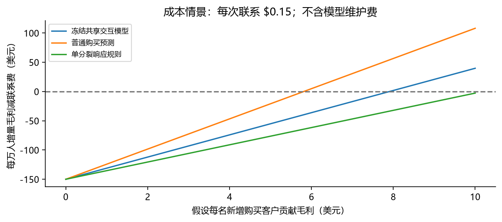

# 购买增量提升实证：有限预算下的促销选人

日期：2026-10-15  
数据：Udacity 官方 Starbucks 随机促销练习。主预算：联系 10% 客户。  
状态：首次正式留出评价完成；保留所有首次结果与失败记录。

## 摘要

一家零售商只能向部分客户发送营销消息，希望在联系人数不变时，多带来原本不会发生的购买。本项目研究怎样选择联系对象：直接随机选人、挑最可能购买的人，还是估计谁更容易因营销改变行为。评价时，把整批符合条件的客户都算进来，观察同样的联系名额能额外带来多少购买。

本轮在训练前固定六个有限候选及一个购买预测参照，用官方训练数据内部的独立验证集选择策略，保留官方测试集作首次正式评价。冻结的共享交互模型在联系 10% 客户时，相对同预算随机，每万人预计增加 **9.36 名购买客户，95% 区间为 [2.56, 16.49]**。AIPW、直接加权与直接组均值评价方向一致，三种区间下界均大于 0。在公开材料所支持的随机实验解释下，本轮获得了优于随机选人的购买正增量证据。

普通购买预测的点估计更高；冻结模型尚未证明优于它或单分裂响应规则。开发集消融也没有支持处理交互带来额外改善。该结果支持继续验证低成本的个性化选人，不支持以算法复杂度决定方案，更不能直接解释为企业已经兑现的利润。匿名特征不能验证购买周期或活跃变化，长期线上影响仍未验证。

## 1. 业务问题：把联系名额用在哪里

营销人员面临的是一个具体选择：这次活动能够联系哪些客户。有人不联系也会买，有人可能因联系而购买；如果只找购买率最高的人，可能把名额花在自然购买者身上。另一方面，购买倾向与营销响应也可能相关，普通购买预测因此可能成为有效且便宜的方案，不能预先排除。

主预算固定为 10%，是项目的资源约束情景，不能说成 Starbucks 的真实最佳投放比例。5% 和 20% 从一开始就只作敏感性分析。比较对象使用相同人群、同一购买标签和相同联系人数。

令 π(X) 为选择联系的规则，q 为联系比例，τ(X) 为给定实验前信息时的平均购买处理效应，主要评价为：

$$
\Delta(\pi,q)=E[(\pi(X)-q)\tau(X)].
$$

Δ 乘以 10,000，表示每万名符合条件客户相对随机选人多增加多少购买客户。分母始终是全部符合条件客户，未按到店、购买或是否实际被选中筛掉客户。正结果的标准是冻结策略相对随机的差值区间下界大于 0；是否值得增加维护成本还要另行判断。

## 2. 为什么这次可以继续做实证

上阶段优先审查 RetailHero，但随机设计、活动时间与窗口等仍未补齐；Lenta 的文档目标是到店。Starbucks 已有官方随机促销和购买说明，却没有可解释的历史字段。本轮依据用户继续验证效果的要求，显式补充研究范围：使用这个已审查候选实际评价购买选人，购买周期与活跃变化机制保持未验证。旧审查记录不覆盖，也不把字段语义的缺失当作所有统计分析都不能进行的理由。

Udacity 官方练习说明促销随机发送，V1–V7 用于选人。Huang 与 Ascarza 的工作论文附录 F 也将它作为随机实验，称这些协变量为处理前信息，并使用分配概率 e=0.5。本轮据此开展公开练习队列的评价，另做分配概率敏感性分析。[官方练习](https://github.com/udacity/DSND_Term2/blob/master/portfolio_exercises/Experiments/Starbucks.ipynb)、[工作论文](https://www.hbs.edu/ris/Publication%20Files/24-034_73dcd8bc-6187-4c84-9a1f-5fc765b03181.pdf)

数据来自官方目录，两份文件的 Git blob 与下载后内容一致。官方训练集共 84,534 人，内部划分 63,400 人拟合、21,134 人验证；官方测试集 41,650 人完整保留。客户 ID 唯一且互不交叉。保留原始外部测试文件，比为了强行凑 50%/20%/30% 而混合原划分更容易追溯。该调整在训练标签分析之前登记。

正式测试的对照组 20,902 人、购买 141 人；促销组 20,748 人、购买 339 人。精确日历窗口、企业送达记录和原始发布过程未获企业内部核验。结果仅适用于此公开实验的解释前提，不能外推未来渠道、长期复购或真实公司利润。

来源记录区分官方文件、作业镜像、论文部分正文与摘要。未将不同的 Starbucks 行为模拟数据混入本案例，也未将本案例未经核实称为合成数据。研究材料均留在本地，没有再发布客户数据。

## 3. 怎样限制建模，避免寻找最好看的随机数

建模前保存 protocol_v1.json，固定数据、特征、预算、六个候选、参照、选择标准和评价方法。实际只比较共享模型的三档交互收缩、预算策略树的三档深度，以及一个固定购买预测参照。30 次重训用于稳定性诊断，不是三十个新增候选。

共享模型采用五个匿名离散变量和两个连续变量。离散变量作独热编码，连续变量用有限样条表示；预处理只在拟合样本学习。购买模型和策略树得到相同的信息，ID 只负责同分边界顺序，不进入模型。

共享模型的结构为：

$$
\operatorname{logit}P(Y=1\mid X,T)
=\beta_0+f(X)^\top\beta+(T-\tfrac12)\{\alpha+s f(X)^\top\gamma\}.
$$

它用所有开发客户学习共同购买规律，只给处理差异留下有限且受收缩的自由度。将交互设计乘以较小的 s，在固定 L2 惩罚下会更强地限制交互系数，降低少量购买事件造成的差分噪声。预测的购买增量来自同一客户“给促销”和“不给促销”的概率差，而不是分类 AUC。

另一族是直接预算策略树：用交叉拟合 AIPW 评分评价分区，按叶子平均评分分配精确预算，以预算价值选择切分。它没有最小化伪结果平方误差，也不是 policytree 论文算法的完整复现。该实现采用贪心搜索，存在局部选择限制。[策略学习论文](https://arxiv.org/abs/1702.02896)

拟合数据内部使用三折交叉拟合生成策略树目标；验证集评分的辅助模型只在拟合部分训练。七个方案在验证集上按 10% 预算评价，再选一个最终策略。最终选择为 **shared_s005**，验证增量为每万人 11.49 人；购买预测为 11.25 人，差距很小。选择依据是预先约定的点估计标准，不能把这点开发差距说成已证明胜出。

选择后，固定规格在全部官方训练集重训，并在只读取测试特征时保存预测文件及哈希。随后才登记测试标签开启记录。正式测试没有用于选择模型、预算或训练种子；首轮结果文件拒绝被脚本覆盖。

## 4. 首次留出结果：确有正增量，复杂方法优势未成立

主预算选择 4,165 人。名单中，实验对照 2,096 人、购买 15 人；实验促销 2,069 人、购买 54 人。这些观测购买次数是评价证据，不是直接观察到的“被营销说服的人数”。

| 方案 | 新增购买/万人 | 95% 区间 |
|---|---:|---:|
| 冻结共享交互模型（主要检验） | 9.36 | [2.56, 16.49] |
| 普通购买预测（参照） | 16.20 | [8.38, 24.62] |
| 单分裂响应规则（参照） | 5.12 | [-1.57, 12.02] |

表中购买预测与响应规则是预先登记的参照。它们对随机的区间用于展示；只有冻结策略相对随机是本轮主要检验。不能在看过测试后把更高点估计的购买模型改名为“验证集选出的赢家”。

冻结策略相对购买预测的差值为每万人 -6.83 人，两个次要比较控制下的 97.5% 区间为 [-16.46, 2.39]；相对单分裂规则为 4.25 人，区间 [-7.91, 16.04]。均包含 0。两项比较的 Holm 校正正态近似 p 值分别为 0.193、0.421，没有依靠各自区间是否重叠作判断。

| 主要比较的估计量 | 每万人新增购买 | 95% 区间 |
|---|---:|---:|
| AIPW | 9.36 | [2.56, 16.49] |
| 直接 HT | 9.22 | [2.35, 16.62] |
| 直接组均值（Hájek） | 9.35 | [2.52, 16.58] |

三个估计量使用同一名单和整批测试客户。直接组均值与 HT 不依赖结果模型学得是否准确；它们和 AIPW 的接近，说明本次正结果没有仅靠某个结果模型外推获得。不过，三者共同依赖对随机实验及发布队列的解释，数值一致不能自动证明所有来源前提。

在 5% 和 20% 预算下，冻结模型每万人相对随机的点估计分别为 5.80 与 23.96。这些是预先登记的敏感性结果，不替代 10% 主结论，也不能据此推荐“20% 是企业最佳预算”。e 从 0.45 到 0.55 的点敏感性保持正向，仅说明这一数值扰动下方向未改变。

## 5. 增量信号来自哪里，哪些改进没有带来收益

开发集 V4=1 时，对照与促销购买率分别为 0.727%、0.698%；V4=2 时为 0.770%、2.176%。两个状态自然购买率接近，促销后的差异较明显。这与特征包含营销响应信息相一致。它不是从“促销后谁买得多”直接推出增量，比较始终包含同状态中的实验对照。

V3 的开发分层也显示响应变化。随后作固定规格消融，只在已经使用过的开发数据评价，没有用它们重新选择测试模型：

| 开发集诊断版本 | 每万人相对随机新增购买 |
|---|---:|
| 完整模型 | 11.49 |
| 去掉 V4 | 9.18 |
| 去掉 V3 | 8.08 |
| 去掉 V4、V3 | 0.37 |
| 只保留 V4 | 2.47 |
| 去掉全部处理交互 | 11.71 |

去掉 V4、V3 后收益接近 0，支持这两类信息对当前排序有用；单独保留 V4 又不足以重现完整收益。由于两个变量各自删除仍保留部分收益，不能把差值机械相加当作贡献分解。

更关键的是：**去掉处理交互并没有使开发结果变差。** 共享交互模型与购买预测的分数 Spearman 相关为 0.884。在购买较稀少、自然购买倾向与响应同向时，共享主效应或购买模型就可能排出有效名单。当前证据支持可利用的信息，却不支持复杂交互是提升的必要来源。

深度更高的预算树在验证集没有稳定改善。树需要同时估计切分与叶子效应，贪心局部优化和有限事件都可能带来误差。本轮结果只能排除“这三档既定树设置已经更好”的说法，不能证明所有策略学习方法无效。

字段是匿名的，V4、V3 不能命名为补货阶段、忠诚度或活跃下降。补货周期和活跃变化的业务机制仍需可解释历史才能验证。这里解释到“哪些信息支持了排序”，不声称读出了客户心理。

## 6. 稳定性和区间方法还有哪些限制

30 次训练样本重采样后，冻结规格与原名单的平均 Jaccard 为 0.395，平均重合比例 55.8%；整体分数相关平均 0.952。这说明总体排序相近，预算边界上的具体人选仍会变化。不能只拿高相关系数宣布名单稳定，也不能把“前 10% 人群”当作永久固定的客户类型。

主要区间在每次人口重采样中重新执行精确配额排序，保持各方案在同一批客户上的关联。它针对给定已训练评分规则的评价不确定性，不包含模型选择与完整重训的不确定性。固定规格重训诊断另行报告，没有把三十次训练当独立实验合并显著性。

最初的辅助模拟使用 Wald 近似，异质性场景覆盖率为 92.4%。正式协议从开始就采用重排序 Bootstrap，因此另做实际方法的覆盖检查。三种场景各 250 次、每次 399 个重抽样，覆盖率依次为 97.2%、96.0%、96.8%。这些有限模拟没有提示明显的虚假增量，但不是覆盖率保证；模拟结果也不计作真实数据正效果。

## 7. 业务上今天应该怎么做

本轮已支持“同预算选人可以优于随机”的离线判断。它还不足以支持为专门 uplift 系统增加高额维护成本：购买预测点估计更高，二者差异仍不确定；前 10% 名单也存在训练波动。

对运营的建议是：把低维护成本的购买预测和冻结共享模型作为下一轮同预算策略实验的候选，优先审查可部署性、成本和名单稳定性。不要直接根据本次测试把新赢家反复换来换去，也不要把匿名特征规则直接作为业务原因解释。

如果每位新增购买客户贡献毛利为 m，面向 N 名客户，模型相对随机可承担的额外实施维护成本上限为：

$$
C_{\max}=N m \Delta.
$$

同预算且每次联系成本相同时，共同联系费用抵消。以每万人、m=3 美元的情景为例，冻结模型相对随机可承担的额外成本点估计仅为 28.09 美元。这里的 m 是假设，不能从练习收入直接推出。

购买增量为正也不自动表示活动赚钱。沿用练习每次促销 0.15 美元的假设，每万人联系 1,000 人要花 150 美元。冻结模型相对不促销预计增加 18.97 人购买，贡献毛利需达到约 7.91 美元/新增购买客户才能覆盖联系费，且尚未计模型成本。

若错误地把 10 美元收入全当贡献毛利，会得到每万人 39.73 美元的点收益；其对应区间 [-34.67, 116.85] 仍跨 0。这个数只能称收入减联系费的情景，不能称实际利润。普通购买预测的相应盈亏平衡毛利约 5.81 美元，仍需业务成本记录确认。

下一次线上验证应把客户随机分到“冻结策略”和“随机选人”两种政策，每一政策组都按 10% 联系，以全部分配到该政策组的客户计算购买。不是只比较收到促销的人。保持固定窗口、活动内容和停止规则，记录送达、毛利、退订投诉和后续购买。

| 计划检出每万人新增购买 | 每个政策组所需客户 | 总客户 |
|---|---:|---:|
| 5 | 495,503 | 991,006 |
| 10 | 127,649 | 255,298 |
| 20 | 33,760 | 67,520 |

样本量按双侧 5%、80% 检验力及项目计算的基线率情景规划，不是已经实施的线上实验，也不是用观察到的 p 值做“事后检验力”。预算、成本、基线率和长期效应变化时应重新设计。

## 8. 验证、可复现记录与未完成事项

本轮新增七项核心行为测试，先记录失败再实现；与旧研究测试合并，最终 35 项通过。独立 SQLite 汇总重新计算直接效果，另写代数核对 AIPW；八项独立检查通过，容差为 1e-12。所记录的 372 个原有文件中，除项目日志按 AGENTS 要求追加本轮索引外，其余 371 个哈希保持不变；日志原内容的前缀哈希也核对一致。

保留协议、开发成员名单、首次选择、预测哈希、测试开启记录、首轮正式结果、配对重抽样、模型与诊断。测试最初因旧模块导入路径出现三个收集错误，补齐路径后通过；独立核对脚本修正了 T 列与 DataFrame 转置属性冲突、NumPy 布尔序列化问题。原失败日志保留，未修改首轮正式效果。

“优于同预算随机”的主要目标在本公开随机练习中获得支持。尚未完成的事项包括：购买周期/趋势机制、RFM 对照、专门增量方法胜过购买预测、全流程训练不确定性、真实线上利润与长期效果。Hillstrom 和 Criteo 的旧结论仍保持原范围，不因新结果改写。

复现与文件入口见 README.md。所有原始数据、客户级证据和模型仅保存在私有研究目录；GitHub 没有自动更新。
